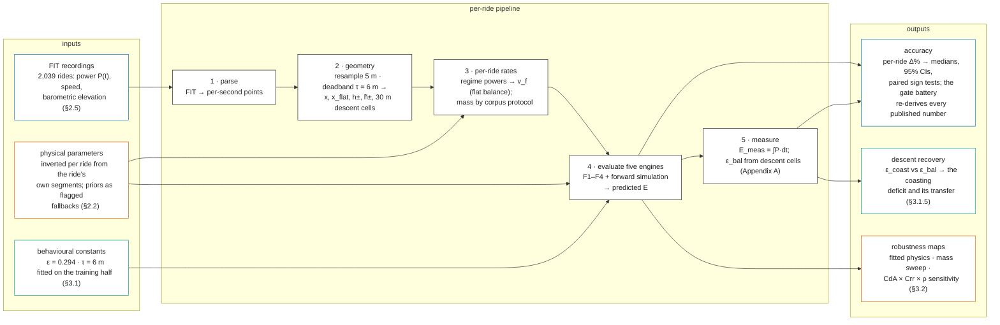
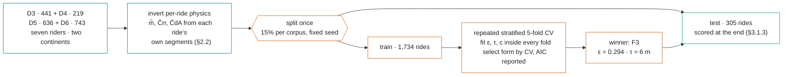

<!-- Claim annotations for this article live in paper1-closed-form.meta.ttl, keyed to the
     invisible @c-<id> anchors in the text below. See that file for the rationale. -->

<!-- DRAFT v3 — IMRAD paper. v2 was revised after the six-lens adversarial review
     (2026-07-27); v3 (2026-08-24) is an editorial refactor: figure/table numbering
     made contiguous (Figures 1-4, Tables 1-6), stale anchors and cross-references
     repaired, duplicated restatements compressed, and several stale numbers
     corrected against the gate battery (0.05 pp transfer, c = 1.10, 2,039-ride
     figure counts, epsilon_0 band 0.10-0.19). v3.1 (2026-09-25): Table 3 and every
     restatement moved to the post-Entry-57 chain (3.24 / 3.19 / 153 of 305, test-half
     eps optimum 0.282), the held-out half's re-scoring disclosed in §3.1.4, and
     F4's c = 1.10 re-read as a value paired with eps rather than platform
     pre-smoothing (paper 2 measures 3.0 m/km on these streams). Single-language
     draft for review.
     Sources of truth: research/journal/MODEL_COMPARISON_JOURNAL.md (numbers),
     journal.qmd (reproduction map). All values are the current, re-baselined ones
     (G = 9.7864), verified against src/harness/bootstrap_ci.py and the harness
     CSVs. Math in LaTeX ($...$); render target is pandoc/KaTeX. Figures 2-3 are
     mermaid blocks: the publish pipeline must render them (mermaid.js via
     CDN+SRI in the /modelo/ template, or pre-render at build); GitHub renders
     them natively. -->

# A Closed-Form Model for the Mechanical Energy of Cycling a Route, Evaluated Against 2,039 Power-Metered Rides

**Danilo Lessa Bernardineli** — Dynamical Systems Group; Pedal Hidrográfico, São Paulo

## Abstract

**Background.** The energy of cycling a route has three parts: a cost per kilometre, a cost per metre climbed, and a partial refund per metre descended. Yet it is hard to obtain: route planners optimise time; the tools that do cost energy are simulation-based and leave route-level accuracy unpublished; and the physics literature validates instantaneous power or speed, never the route-level integral. A closed form simple enough for pen and paper — or a million edge evaluations per second in a router — would unlock it, if it can be trusted.

**Methods.** We test four models built on one three-term closed form, $E \approx \alpha\,x + \beta\,(h_+ - \varepsilon\,h_-)$ — flat rate $\alpha$, climbing rate $\beta$, refunded fraction $\varepsilon$ — against the power-meter energy $\int P\,dt$ of 2,039 rides from four corpora and seven riders — three in São Paulo, four in Europe. Each ride's physical constants (mass, rolling coefficient, drag area) are inverted from its own telemetry; the behavioural constants — the descent-recovery factor $\varepsilon$ and the smoothing deadband $\tau$ — are fitted by cross-validation on a training half, frozen, and scored on a held-out half that took no part in fitting them or in choosing the form. The reference is a forward-dynamics simulation [Martin et al. 1998] reading the same constants per ride, so gaps between the models isolate modelling error. Both engines read the ride's measured power, so accuracy means consistency of the energy accounting, not blind prediction.

**Results.** On 305 held-out rides used neither to fit its constants nor to choose its form, the selected form reproduces measured energy to **3.24% [2.75, 3.50] median error**<!--@c-e52.f3.med.abs--> at +0.07% [−0.31, 0.70] bias; its totals-only variant — needing route totals and a climbing share — reads 2.86% [2.58, 3.39]; the forward simulation, on the same rides, 3.19% [2.73, 3.74] at −0.10%. A paired test separates none of them (153 of 305, $p = 1.00$). The claim is therefore **parity, not superiority** — and it is the stronger reading, because the simulation walks the same profile with velocity carried between segments and converts that extra information into no accuracy.

Cross-validation and AIC select the same form; the descent constant refits to $\varepsilon = 0.294$ against 0.282 on the held-out half's own optimum, so it is identified rather than an artefact of the draw; and fitted on **one** rider it carries to the rest at a cost of 0.05 pp, far inside the ±1.0 pp margin registered in advance as the threshold for mattering. A Sobol decomposition shows why $\varepsilon$ is carried as a calibrated constant: it accounts for 7% of prediction-error variance against 55% for drag area and 46% for mass — and $C_dA$ and $C_{rr}$ prove not separately identified by route-level energy, their combined flat resistance $\alpha$ determined two to three times better than either part. One exposure is reported rather than assumed away: 82% of held-out rides have a same-rider training ride within 5% on distance and 10% on ascent, so the headline is a repeat-route error.

**Scope.** Seven riders, all on conventional road bicycles with power meters; the behavioural constants are calibrated at a 30 m elevation scale and paired with an assumed $\rho\,C_dA$. Whether the descent-recovery constant holds for utility commuters, e-bikes, cargo bikes or recumbents is untested, and the transfer claim rests on two independent riders plus four external ones — a thin base for a behavioural constant, and the limit most likely to bind in deployment ([§4.3.1](#4.3.1)).

**Conclusions.** The proposed F3 — air resistance charged only off the climbs, elevation totals smoothed — matches the simulation; F4, its totals-only approximation, performs as well and is computable by hand from distance, ascent, descent and a rough climbing share. Descent recovery has a geometry (a parameter-free recovery ceiling) and a habit (the coasting deficit), and the habit's spread across riders is behavioural. The law is cheap enough to serve as a per-edge routing cost at the sampling scale it was calibrated on.

**Keywords:** cycling energetics, active transportation, route planning, energy-optimal routing, power meter data, elevation gain estimation, digital elevation models, closed-form approximation, territorial planning, open science

## Contributions

1. **A hand-computable route-energy law.** The three-term form $E = \alpha_r\,x + \alpha_a\,x_{\mathrm{flat}} + \beta\,(\tilde h_+ - \varepsilon\,\tilde h_-)$ and its totals-only approximation F4, derived from the route-energy integral ([Appendix A](#appendix-a)), validated against a forward simulation and 2,039 measured rides from seven riders, and found statistically indistinguishable from the simulation ([§3.1](#3.1)).
2. **Two failure modes of the naive closed form, identified, attributed and cheaply fixed**: climb aerodynamics charged at the flat reference speed, and sub-metre elevation noise (plus momentum-paid micro-relief) counted as climbing — with independent attribution checks for each ([§1.2.3](#1.2.3), [§3.1](#3.1)).
3. **A descent term with a mechanism, held as a constant — and an apportioned error budget.** $\varepsilon$ is not a free coefficient: it decomposes into a parameter-free geometric ceiling and a behavioural shortfall whose ledger identity makes it a measurement of descent pedalling *occupancy* ([§4.4.2](#4.4.2)). A Sobol decomposition shows its value accounts for 7% of prediction-error variance against 55% for drag area, which is why this paper carries it as a calibrated constant; the same decomposition shows $C_dA$ and $C_{rr}$ are *not separately identified* by route-level energy — their combined flat resistance $\alpha$ is determined two to three times better than either part, so improving one alone can make an estimate worse ([§3.2](#3.2)).
4. **Evidence that the descent constant transfers.** Fitted on one rider and carried unchanged to the other riders — including an open European deposit sharing no rider, country, terrain regime or recording device with the São Paulo data — it costs 0.05 pp of median accuracy; between landscapes it carries as one re-fitted number, and a synthetic sweep attributes 94% of the regional gap to terrain rather than to the people riding it ([§3.1.5](#3.1.5)). The scope condition travels with the claim: only the (cost, refund) *pair* is identified by ride energies, so re-pairing the law with different physics requires re-calibration ([§4.3.2](#4.3.2)). The same external corpus shows F4's scalar $c$ failing to travel where the *form* does not — its recording chains carry 1.3 m/km of phantom climb against the 3.0 of the São Paulo streams [paper 2] — the sharpest evidence that $c$ belongs to the elevation source rather than to cycling. Fitted jointly with $\varepsilon$ the scalar falls further, to 1.10 m/km, a paired value rather than a measured rate ([Table 2](#tab2), [§2.5](#2.5)).
5. **A frozen-constants evaluation methodology, fully automatic per ride.** Constants calibrated once on a training half and carried blind; a segment-based mass inversion validated against logged and known masses plus a regime-consistent aero estimator, with fallback rates reported rather than hidden ([§2.2](#2.2)); every published number re-derived by a public gate battery, with per-entry research packages ([§2.4](#2.4)).
6. **A physical reading of the smoothing scale, and a deployed use.** Rider momentum as a travel-limited suspension ($h_{KE} = v^2/2g$; dissipation length $\lambda = m/\rho C_dA$, exact and $C_{rr}$-free) explains what the deadband removes ([§4.4.4](#4.4.4)). The law is in use in three registers: as a per-edge routing cost, as a spreadsheet a cycling collective plans tours with, and — because it turns terrain into an energy field rather than a distance — for territorial planning ([§4.1](#4.1)).

## Terminology

Symbols used throughout; grades are percent in the text, fractions in formulas; "—" in the unit column marks dimensionless quantities; corpus labels D3–D6 are defined in [Table 1](#tab1). Display equations are numbered (1)–(7) in the main text and (A1)–(A9) in the appendix; the four model forms are named and tagged F1–F4.

A **bare parameter symbol is a frozen constant**; letter subscripts are *names*, not scopes ($\alpha_r$ rolling, $\alpha_a$ aero, $v_f$ flat, $\varepsilon_d$ dynamic, $k_{\mathrm{eff}}$). The *value* column gives the frozen value, or the variable's scope: **person**, **ride**, **local** (along the route), **instant** (per second).

Every result table names, in its caption, the corpora, the parameter protocol and the harness CSV its rows derive from; the public gate battery ([§2.4](#2.4)) re-derives every published statistic from those CSVs. Parameter protocols are two: the **frozen priors** (the four constants below at their table values) and **per-ride fitted physics** (each ride's $m$, $C_{rr}$, $C_dA$ inverted from its own telemetry, [§2.2](#2.2)).

| symbol | unit | value | name | meaning |
|---|---|---|---|---|
| $E$ | J | ride | route mechanical energy | Pedal energy over the route; ground truth is the power-meter integral $\int P\,dt$. |
| $x$ | m | ride | route distance | Ground distance. |
| $h_+$, $h_-$ | m | ride | total ascent, descent | Summed climbing / dropping, raw profile; deadband-smoothed totals are $\tilde h_+$, $\tilde h_-$ ([§1.2](#1.2)). |
| $x_+$, $x_-$, $x_{\mathrm{flat}}$ | m | ride | climbing, descending, non-climbing distance | Distance on grades ≥ 2%, descending distance, and $x - x_+$; aero is charged only on $x_{\mathrm{flat}}$. |
| $s$ | — | local | grade (slope) | Rise over run (2% in text ≡ 0.02 in formulas); negative on descents in the regime definitions, magnitude in descent formulas ($\bar s = h_-/x_-$). |
| $m$ | kg | person | total system mass | Person + bicycle + gear; inverted per ride from the ride's own climbing data ([§2.2](#2.2)). |
| $g$ | m/s² | 9.7864 | local gravity | São Paulo's measured value (IAG-USP). |
| $C_{rr}$ | — | 0.008 | rolling-resistance coefficient | Rolling drag as a fraction of weight. |
| $C_dA$ | m² | 0.40 | drag area | Frontal area × drag coefficient. |
| $\rho$ | kg/m³ | 1.13 | air density | At São Paulo's altitude. |
| $k_{\mathrm{eff}}$ | — | 0.98 | drivetrain efficiency | Fraction of leg power reaching the wheel. |
| $w$ | m/s | 0 | headwind | Held at zero throughout ([§4.3.3](#4.3.3) prices the omission). |
| $v_f$ | m/s | ride | flat reference speed | Flat cruising speed, derived per ride from its own flat-regime power ([§2.1](#2.1)); sets the aero charge, anchors the two models. |
| $P$ | W | instant | pedal power | Measured per second by the power meter. |
| $\alpha_r$, $\alpha_a$ | J/m | person, ride | rolling, aero cost rates | Energy per metre for rolling, and for air at the relative speed $v_f + w$ (so $\alpha_a$ inherits $v_f$'s per-ride scope); $\alpha = \alpha_r + \alpha_a$. |
| $\beta$ | J/m | person | climbing cost rate | Energy per metre climbed: $mg/k_{\mathrm{eff}}$. |
| $s_*$; $s_+$, $s_-$ | — | person | flat-resistance grade; gravity-dominated regimes | Break-even slope $s_* = \alpha/\beta$ (1.8–2.2% at these corpora's flat speeds, [§2.2.1](#2.2.1)); beyond it gravity dominates — ascents $s_+$ collapse speed, descents $s_-$ shed the surplus gravitational power to over-speed drag or braking. |
| $s_=$ | — | — | flat band | $\lvert s\rvert < s_*$: resistance dominates, aero at $v_f$ is fair, descents refund fully; the 2% gate approximates its edge. |
| $\varepsilon$ | — | 0.294 | descent-recovery factor | Fraction of descent potential energy refunded; fitted on the training half ([§3.1.2](#3.1.2)) and carried as one constant for every route. Per-ride measured values exist and can be negative ([Appendix A](#appendix-a)). |
| $\varepsilon_d$ | — | ride | dynamic $\varepsilon$ | Geometry-derived variant: the drop-weighted coasting ceiling less the deficit $\varepsilon_0$ ([§4.4.2](#4.4.2)); adapts the refund to descent grade, reported for comparison, not recommended ([§4.1.2](#4.1.2)). |
| $\varepsilon_0$ | — | 0.13 | coasting deficit | Gap between ideal and measured recovery ([§4.4.2](#4.4.2)); 0.13 at the shared priors and 30 m scale (0.10–0.19 across plausible physics and pairings); recurrence robust, value conditional. |
| $c$ | m/km | per source | ascent-noise rate | Phantom climb per route-km, subtracted from raw totals in F4; 3.1 measured on raw barometric recordings ([§2.5](#2.5)); 1.10 when fitted jointly with $\varepsilon$ on D3–D6 ([Table 2](#tab2)), a paired value rather than a measured rate. |
| $\tau$ | m | 6 | deadband threshold | Elevation changes below $\tau$ are ignored when summing $h_\pm$; fitted on the training half ([§3.1.2](#3.1.2)). |
| $\Delta\%$ | % | ride | per-ride signed error | $(E_{\mathrm{model}} - E_{\mathrm{meas}})/E_{\mathrm{meas}}$; corpora summarized by medians of $\Delta\%$, $\lvert\Delta\%\rvert$. |

## 1. Introduction

### 1.1 An absent quantity

How much energy does it take to cycle a route? The question is basic — it determines how far a commuter can ride, how a collective plans a group ride through hilly terrain, whether a cargo-bike delivery round is feasible — and yet a trustworthy answer is hard to come by. Production bicycle routers cost *time*, with heuristic hill penalties; research prototypes have costed energy per edge [Shirabe 2008; Hrnčíř et al. 2017; Cakir et al. 2026], but their route-level accuracy against measured power is unpublished (our own experimental deployment, [§4.1](#4.1), is the exception that motivated this study).

The tools that do estimate ride energy are simulation-based pacing planners or platforms' post-hoc estimates: opaque to their users and, to our knowledge, never validated against measured route-level power in the open literature. The sports-science literature validates the *instantaneous* power balance to high precision [Martin et al. 1998; Dahmen et al. 2011] but not the route-level energy integral; route-choice models absorb elevation into fitted coefficients with no physical form [Scarf & Grehan 2005]. Energy is not so much absent from the toolbox as locked inside simulations — out of reach of a router that must cost thousands of edges, and of a rider with pen and paper.

Two audiences would use it if it were computable, and they impose opposite constraints. A routing engine must evaluate thousands of candidate edges, which rules out forward simulation and demands a closed form. A rider — or anyone teaching riders — needs something even stricter: a formula that works with pen and paper, from the three numbers any map already gives (distance, total ascent, total descent). Both constraints point to the same object, and Occam points there too: the simplest law that survives contact with measured data is the one worth deploying.

### 1.2 The proposed law

#### 1.2.1 The three-term shape

We propose an approximation that decomposes the mechanical work of a ride into three terms: (1) a cost per metre of horizontal distance — rolling and aerodynamic resistance — expressed by the rate $\alpha$; (2) a cost per metre of ascent — a gravitational *deposit* — expressed by the rate $\beta$; and (3) a partial *refund* per metre of descent — the deposit withdrawn back as forward progress — expressed by the recovery factor $\varepsilon$. Terms 1 and 2 are widely known: together they are the textbook steady-speed energy integral, resting on physics validated since the equation-of-motion experiments [di Prampero et al. 1979; Martin et al. 1998]. Term 3 is novel, and it carries a behavioural quantity: $\varepsilon$ decomposes into a parameter-free geometric ceiling and a behavioural shortfall that measures how often riders pedal downhill. This paper uses $\varepsilon$ as a calibrated constant, because that is what its share of the error budget warrants ([§3.2](#3.2)); [§4.4.2](#4.4.2) develops the decomposition and [Appendix A.5–A.6](#A.5) derives it.

The nearest prior treatments are oblique — a per-grade coasting idle limit in a speed-choice model [Bigazzi & Lindsey 2019], per-instant regeneration efficiencies in electric-vehicle models — but never a route-level, closed-form recovery factor; [§4.2](#4.2) maps the prior art. The three terms give the shape every form in this study shares, eq. (1),

$$E \;\approx\; \alpha\,x \;+\; \beta\,(h_+ - \varepsilon\,h_-), \tag{1}
$$

with one flat cost rate $\alpha = \alpha_r + \alpha_a$, one climbing rate $\beta$ and one recovery factor $\varepsilon$, whose rates eq. (2) fixes:

$$\alpha_r = \frac{C_{rr}\,m g}{k_{\mathrm{eff}}}, \qquad \alpha_a = \frac{\tfrac{1}{2}\rho\,C_dA\,(v_f + w)^2}{k_{\mathrm{eff}}}, \qquad \beta = \frac{m g}{k_{\mathrm{eff}}}, \tag{2}
$$

with $w$ the headwind, held at zero throughout this study's evaluation, so $\alpha_a$ reduces to the $v_f^2$ form ([§4.3.3](#4.3.3) prices that omission).

#### 1.2.2 The four forms

We evaluate four forms of this family. They are not independent alternatives but a causal chain of refinements, each step addressing the previous form's main limitation: F1, the shared shape as-is, led to F2 (splitting the flat rate), which led to F3 (smoothing the elevation), which led to F4 (approximating the smoothing when only totals are available). Writing $\tilde h_\pm$ for the deadband-smoothed elevation totals:

1. **original** — air resistance at the flat reference speed over the whole distance; raw elevation totals:
   $$E_1 \;\approx\; \alpha\,x \;+\; \beta\,(h_+ - \varepsilon\,h_-); \tag{F1}
$$
2. **split** — the aero part gated off climbs, rolling still paid everywhere:
   $$E_2 \;\approx\; \alpha_r\,x \;+\; \alpha_a\,x_{\mathrm{flat}} \;+\; \beta\,(h_+ - \varepsilon\,h_-); \tag{F2}
$$
3. **split + elevation smoothed** — the elevation profile deadband-filtered point by point before summing, so $\tilde h_\pm$ are noise-free (the form we propose):
   $$E_3 \;\approx\; \alpha_r\,x \;+\; \alpha_a\,x_{\mathrm{flat}} \;+\; \beta\,(\tilde h_+ - \varepsilon\,\tilde h_-); \tag{F3}
$$
4. **split + elevation correction** — F3, with the smoothed totals approximated from the raw ones, for when only $x$, $h_+$ and $h_-$ are known:
   $$E_4 \;\approx\; \alpha_r\,x \;+\; \alpha_a\,x_{\mathrm{flat}} \;+\; \beta\,(\tilde h_+ - \varepsilon\,\tilde h_-), \qquad \tilde h_\pm \approx h_\pm - c\,x. \tag{F4}
$$

All four forms are derived from the route-energy integral in [Appendix A](#appendix-a), and all four are scored against measured energy in [§3.1](#3.1) ([Table 2](#tab2), [Table 3](#tab3)). All symbols and their plain-word meanings are collected in [Terminology](#terminology); [Figure 1](#fig1) maps each term of the proposed form onto a route profile; the filter threshold $\tau$ and the noise rate $c$ are specified below.

). The deadband filter addresses both — measurement hygiene and, in part, a kinetic-energy accountability mechanism.](figs/fig9-anatomy.svg)

#### 1.2.3 The two corrections

The family's physical ingredients are well validated, but only below the route scale: the underlying power balance against steady-velocity trials on flat ground [Martin et al. 1998], and simulators built on it against speed on real tracks [Dahmen et al. 2011] — never against the route-level energy integral. Two systematic errors that only exist at that integral scale — one born when the closed form lumps aero into a single reference speed, one born when noisy elevation steps are summed into $h_+$ — therefore had no occasion to be noticed, let alone corrected. We propose two corrections; both are calibrated on this study's data and then frozen ([§2.4](#2.4)).

- **Climb-aero split.** The original form bills air resistance at $v_f$ over the whole distance, but on ascent-dominated grades ($s_+$) speed falls far below $v_f$, so it over-charges every climb. The correction charges aero only over the non-climbing distance $x_{\mathrm{flat}} = x - x_+$; the frozen 2% gate defining $x_+$ is a rounded, rider-generic stand-in for the flat-resistance grade $s_*$.
- **Elevation deadband.** Recorded and DEM (digital elevation model — terrain heights from mapping data) elevation profiles carry sub-metre noise whose positive half-steps all count toward $h_+$ — a measurement artifact, not lifting work [Rapaport 2011]. F3 removes it with a backlash (deadband) filter of threshold $\tau$ — fitted on the training half, 6 m here ([§3.1.2](#3.1.2)) — which leaves sustained climbs intact. F4 approximates the smoothed totals from raw ones, $\tilde h_\pm \approx h_\pm - c\,x$, achieving the same on totals alone: on a raw barometric profile, **subtract about 3 m of phantom climbing per kilometre of route** ($c = 0.003$ with $x$ and $h_\pm$ in metres). The rate is measured, per elevation source, in [§2.5](#2.5). Example: a 50 km ride whose raw profile reports 600 m of ascent is corrected to $600 - 3 \times 50 = 450$ m.

### 1.3 Aim, hypotheses, and scope

**The aim of this study** is to establish that the closed form above accounts for the measured mechanical energy of real rides as well as a full forward simulation does, at a cost that a spreadsheet or a per-edge routing cost can bear. That is a goal rather than a hypothesis: it is what the paper sets out to build, and [§3.1](#3.1) reports how far it gets.

One claim in the construction *is* a hypothesis, because it can fail cleanly and the whole proposal depends on it:

> **Transfer.** The descent-recovery constant $\varepsilon$ is a property of a riding **context** — a landscape and the terrain regime it imposes — rather than of a rider. Within one context it should carry **unchanged** from the people it was fitted on to people who took no part in fitting it. Across contexts it should carry with a **change to $\varepsilon$ alone**: the law, the choice of form, and every other constant stay put.

The two halves fail differently and are tested separately. If the first fails, $\varepsilon$ is a per-rider calibration, the law needs a measurement session per person before anyone can use it, and the deployment case in [§4.1](#4.1) largely collapses. If the second fails — if moving to a new landscape required re-deriving the law rather than re-fitting one number — then nothing here transfers beyond the roads it was measured on, and the paper would be a case study rather than a method.

We test both ([§3.1.5](#3.1.5)). Fitting $\varepsilon$ on a single rider and scoring it on the other riders' held-out rides costs 0.05 pp<!--@c-e54.transfer-->, inside the margin registered in advance as the threshold for mattering. Carrying it between the two landscapes in these corpora — the São Paulo corpora against the European deposit — costs about 0.85 pp (the ride-weighted pooled figure; 0.82–0.92 by region, [§3.1.5](#3.1.5)) if the difference is ignored, and the two contexts want $\varepsilon \approx 0.24$ and $\approx 0.37$ respectively. So the constant does travel between people, and between places it travels as a *re-fitted number* rather than as a re-derived model. That is the weaker claim, and it is the one the evidence supports.

One scope statement applies throughout: each ride is evaluated with its own measured power inputs, and the physical constants are inverted from each ride's own telemetry ([§2.2](#2.2)). Our accuracy figures therefore measure the **consistency of the energy accounting** — whether the law maps a route's geometry and a rider's effort onto the measured energy — not blind route prediction, which would additionally require predicting the rider's power.

## 2. Methods

[Figure 2](#fig2) maps the whole study in one view — the inputs, the per-ride pipeline, and the outputs; the subsections detail each stage, and [Figure 3](#fig3) (in [§2.4](#2.4)) shows how the corpora relate.

**Figure 2.** The study pipeline: inputs, the per-ride pipeline, and outputs. Every arrow is one deterministic harness step; all outputs regenerate from the inputs with one command per corpus.

### 2.1 The reference simulation and the shared-constants design

The reference is given by eq. (3) — a distance-marching forward integration of the standard cycling power balance [Martin et al. 1998; di Prampero et al. 1979]:

$$m\,v\,\frac{dv}{dx'} = \frac{k_{\mathrm{eff}}\,P}{v} - C_{rr}\,m g \cos\theta - \tfrac{1}{2}\rho\,C_dA\,(v + w)^2 - m g \sin\theta, \tag{3}
$$

with pedal power $P$ per grade regime extracted from each ride's own power stream, signed relative wind $w$, and a safe-speed brake cap on descents. The integrator uses a semi-implicit kinetic-energy update that conserves energy to machine precision (the identity $k_{\mathrm{eff}} E_{\mathrm{legs}} = \Delta KE + W_{rr} + W_{\mathrm{aero}} + W_{\mathrm{grav}} + W_{\mathrm{brake}}$ is asserted per ride to $\leq 10^{-6}$ relative).

The design principle that makes the comparison meaningful: **both models read the same physical constants** — mass, $C_{rr}$, $C_dA$, $\rho$, $k_{\mathrm{eff}}$, and the headwind $w$ (held at zero throughout) — per ride. The flat reference speed is likewise shared and derived per ride: the flat-regime pedal power is extracted from the ride's own power stream (speed-gated, time-weighted), and $v_f$ is the speed at which the flat power balance closes — so on flat ground the two models agree by construction, and every gap between them is modelling error, not a parameter mismatch. Gravity is São Paulo's measured local value ([Terminology](#terminology)); D3–D5 are overwhelmingly São Paulo rides, and the handful of away rides retained (other Brazilian states, a few European tours) shift $g$ — hence $\beta$ — by under 0.3%, well inside every published band. D6 is wholly European, where $g \approx 9.805$; it is evaluated at the same constant because the quantity its data identifies is the product $\hat m g$, so the closed forms are invariant under a joint change of mass and gravity and only a comparison against the riders' *published* masses needs the 0.19% rescale (lab journal, Entry 43).

### 2.2 Inverting the physics from the ride

Both engines need three constants per ride — system mass $m$, rolling coefficient $C_{rr}$ and drag area $C_dA$ — and this study obtains them from the ride's own power stream rather than from a rider questionnaire or a wind tunnel. That choice is what makes the evaluation automatic, and it is also the study's principal limitation, so the method and its failure modes are stated here in full.

#### 2.2.1 The cascade

Each ride is segmented into **strict climbs** (grade $\geq 2\%$ throughout, $\geq 40$ m of gain) and **strict in-band flats** ($\geq 1$ km), with transients clipped and a segment kept only if it is well-behaved: no braking events, power present for $\geq 90\%$ of samples, no stops.

The climb threshold is the one choice with a derivation behind it. The ratio $\alpha/\beta$ is the grade at which gravity's contribution equals the *entire* flat resistance,

$$\frac{\alpha}{\beta} \;=\; C_{rr} + \frac{\tfrac{1}{2}\rho\,C_dA\,v_f^2}{m g}\ , \tag{4}$$

the same quantity that sets the recovery ceiling in [Appendix A](#appendix-a). At this study's constants it falls between 1.8% and 2.2% across the flat speeds these corpora actually ride at, so a $2\%$ threshold admits exactly those segments where gravity carries at least half the load — which is the condition under which mass is identifiable from a climb at all. **The remaining thresholds are heuristics.** The 40 m gain, the 1 km flat length and the 90% power-coverage requirement were chosen to exclude segments too short or too gappy to integrate reliably; they are reported as the tuning choices they are, and their influence is bounded by the fallback rates in [§2.2.2](#2.2.2): a threshold that rejects too much shows up there as a fallback, not as a silent bias.

Three estimates are then taken in a fixed order, each consuming the previous one:

1. **$\hat m$ from a temporally spread subset of the climbs.** On a sustained climb $\beta h_+$ dominates the balance, so mass is the best-identified of the three.
2. **$\hat C_{rr}$ from the *remaining* climbs**, at the prior $C_dA$. The split is by count and by position: $\lceil n/3 \rceil$ climbs (at least two) go to mass and the other two thirds to $C_{rr}$, with the mass subset chosen for maximum **temporal spread** — the first and last climbs, then repeatedly the one farthest from every climb already chosen. Two things motivate that. The subsets must be **disjoint**, because on any single climb $m g \sin\theta$ and $C_{rr} m g \cos\theta$ both scale with $m$ and differ only by $\sin\theta$ against $C_{rr}\cos\theta$, so estimating both from the same segment is collinear by construction. And the mass subset must be **spread across the ride**, so that a single stretch — a headwind leg, a change of position, the last hour of a long day — cannot set the constant that scales the dominant climb term. The one-third/two-thirds asymmetry gives the weaker signal the larger sample: on a climb, $C_{rr}$ is the small residual left after gravity, whereas mass is what gravity is measuring. One known, untested inefficiency: the rule does not sort by gradient, and arguably should — mass is best identified on the steepest climbs, and a grade-ordered split would hand the mass subset a 7.5% median gradient where the actual split gives statistically indistinguishable 6.6% against 6.5%. We report it rather than correct it, since changing it would move every downstream number.
3. **$\hat C_dA$ from the ride's own flat regime.** Aerodynamic loss dominates on the flat, so $C_dA$ is read from the flat-regime power $P_{\mathrm{flat}}$ at the **measured** flat speed $v_{\mathrm{meas}}$:

$$\hat C_dA = \frac{k_{\mathrm{eff}} P_{\mathrm{flat}} / v_{\mathrm{meas}} - C_{rr}\,\hat m g}{\tfrac{1}{2}\rho\,v_{\mathrm{rel}}^2}\ ,\qquad v_{\mathrm{rel}} = v_{\mathrm{meas}} + w. \tag{5}$$

   Two properties matter. It needs **no qualifying segment**, only that the ride has a flat regime at all, so it returns a value where a segment-based estimator would fall back. And it is evaluated at the speed the ride was actually ridden at, which is the same speed the closed form later evaluates $\alpha_a$ at — a segment-based estimate is inferred at one speed and used at another, and that inconsistency is not small ([§3.1.3](#3.1.3)).

Wind is set to **zero everywhere in this paper's runs — in the inversion, including eq. (5)'s $v_{\mathrm{rel}}$, and in the model evaluation alike** ([§4.3.3](#4.3.3) prices the omission). The inversion protocol does carry a registered wind rule for runs that use it — zero for round trips, where the out-and-back legs cancel to first order, and otherwise half the historical daily ground wind projected on the net bearing (a heuristic: reported wind is a 10 m meteorological value while a rider sits near 1.5 m in rougher air) — but no number reported here exercises it; the rule and its runs live in the lab journal (Entry 33). A field with no qualifying segment falls back to a flagged default rather than a silent one ([§2.2.2](#2.2.2)).

#### 2.2.2 How often it actually inverts

The fallbacks are not rare, and reporting their rate is the honest description of what "per-ride fitted physics" means in this paper. Across the 2,039 rides of D3–D6, **$C_{rr}$ has no qualifying segment on 77%** of rides, while **$C_dA$ is measured on 97%** — it lacks one on 3%. The aero estimator of eq. (5) is why: an earlier segment-based one fell back on 27%, and replacing it removed most of that gap (lab journal, Entry 55). In the published chain a ride that cannot invert a constant falls back to a **per-rider median** of that rider's own inverted values, not to a generic prior (lab journal, Entry 57) — so no evaluated ride carries a global constant, but for $C_{rr}$ most rides carry their rider's typical value rather than their own. Mass sits between the two: it is inverted from the ride's own climbs on 31% of rides, taken from a marginal set of climbs on a further 19%, and otherwise takes the rider median. So mass is always rider-specific but only sometimes ride-specific — a distinction the phrase *fitted per ride* elides. It is in any case near-constant within a rider: one D6 rider's inter-quartile range spans 99.9 to 99.9 kg — a width of zero — which is why the rider-level fallback costs little.

So the parameter class this paper calls fitted-per-ride is, for most rides, *a per-rider mass and a per-ride drag area with a rider-median rolling coefficient*. Since mass scales the dominant climb term directly ($\beta = mg/k_{\mathrm{eff}}$) and $C_dA$ dominates the flat one, the two that are measured are the two that matter most ([§3.2](#3.2)); results that turn on $C_{rr}$ should be read with the rate above in mind.

#### 2.2.3 What route-level energy can and cannot identify

The fallback rate is a symptom rather than a defect of sequencing. Route-level energy identifies the flat resistance $\alpha$, not its division into rolling and aerodynamic parts: separating a term scaling with $v$ from one scaling with $v^3$ requires speed *variation* within the ride, and at roughly steady speed the two are nearly parallel. [§3.2](#3.2) measures the consequence — $\alpha$ is determined two to three times better than either of its components.

We tested whether a better estimator escapes this. Multiplying the force balance by $v$ makes it linear in $(m,\ m C_{rr},\ C_dA)$, so a single regression over work-balance blocks returns all three jointly, with no cascade, no ordering and no fallback path. On the rides where the cascade genuinely inverts all three — the well-conditioned subset, where any correct method must agree — the joint fit instead returns $m = 63$ kg against 98, with a median condition number near 330 (lab journal, Entry 53). The joint fit removes the fallback *code path* without adding the information the fallbacks stand in for. We therefore keep the cascade and report its rates, rather than adopting an estimator that hides the same deficit behind a plausible number.

#### 2.2.4 Where the inversion sits in the evaluation

The inversion runs **before** the train/test split of [§3.1](#3.1), as data preparation: it is a property of each ride, computed once, and the split then partitions rides that already carry their constants. Two consequences follow, and both bound what the results claim.

The held-out evaluation establishes that the **functional form and a universal $\varepsilon$** transfer to rides that chose neither. It does **not** establish prediction from geometry alone, because every ride — held out or not — carries constants derived from its own telemetry. Predicting a route nobody has ridden needs constants a planner can obtain without the ride, and is outside this paper's scope.

And the constants are fitted under *quasi-steady* conditions, on sustained climbs and flats, then used across whole rides including the accelerations and stops those segments exclude. The closed form absorbs the mismatch into its fitted $\varepsilon$; the forward simulation, which has no fitted parameter, cannot, which is why its error concentrates on the transient-heavy urban corpora ([§3.1.3](#3.1.3)).

### 2.3 Parameter sensitivity: how the error budget is apportioned

A route-energy law is only as trustworthy as the constants it is fed, so we ask which of them the answer actually depends on. We decompose the variance of the prediction error over the four quantities a user must supply — system mass $m$, drag area $C_dA$, rolling coefficient $C_{rr}$, and the descent-recovery fraction $\varepsilon$ — with a Sobol design (Saltelli estimators for first-order $S_i$, total-order $S_{Ti}$ and pairwise $S_{ij}$; $N = 4096$, sample matrices drawn from the project's own deterministic generator so a re-run reproduces exactly).

The output decomposed is the corpus median $\lvert\Delta\%\rvert$, so the answer is to the question a reader actually has: *of the error I would see, how much does each constant account for?* All four forms are decomposed, because a parameter's share depends on how much other error the form still carries — the same absolute effect occupies a larger share as F1 → F3 removes error. Reporting the four together separates importance from residue.

Each form reduces, per ride, to four geometry aggregates — route length, the distance charged aerodynamically, and the corrected ascent and descent totals — after which the energy is arithmetic. The profile is walked once per ride and the design costs no simulation, which is what makes a full Sobol run affordable over every ride rather than a subsample. The single nonlinearity is the flat reference speed, solved from the ride's flat power against $(m, C_{rr}, C_dA)$ and re-entering the aero term quadratically, so every interaction reported has one physical origin.

**Input ranges are measured rather than assumed**, since a variance decomposition ranks parameters partly by how wide their ranges are. The physical constants take the 5th–95th percentiles of the per-ride inversions actually observed ([§2.2](#2.2)); $\varepsilon$ takes its measured spread across the seven riders, 0.08–0.30. Note the asymmetry, which is deliberate and conservative: the physical ranges are what one ride's inversion leaves uncertain, while $\varepsilon$'s is the full across-rider spread a deployer meeting an unknown rider would face. That inflates $\varepsilon$'s apparent share, which is the direction that makes the conclusion below harder to reach. The analysis is repeated under a narrower $\pm 1$ SD parameterisation and we report a verdict only where it survives both.

### 2.4 Data, ground truth, and evaluation protocol

#### 2.4.1 Datasets and roles

**Datasets.** Four corpora — 2,039 rides, of which D3–D5 are ridden overwhelmingly in and around São Paulo (a few away rides retained; [§2.1](#2.1)) and D6 entirely in Western Europe, all with per-second power meters ([Table 1](#tab1); [Figure 4](#fig4) draws every São Paulo route on one map — D6's are withheld, see below). Together they span seven riders, three recording platforms and two continents. Earlier drafts of this work also used two smaller corpora of the author's — a 44-ride brevet set (D1) and a 62-ride urban census (D2) — to calibrate the behavioural constants under assumed resistances. Both are re-processings of D5's rider rather than independent data — D1 is contained in D5, and 58 of D2's 62 rides are the author's recordings also in D5 — so they are neither counted in the population nor reported here; the constants they once set are now fitted on D3–D6's training half instead ([§3.1](#3.1)), and the lab journal retains their results.

**Table 1.** The four corpora and their roles. *rides* is the population this paper evaluates — every ride that parses, carries power and passes the inclusion filters of [§2.4.2](#2.4.2) — which is the number every result below is drawn from.

| corpus | rides (evaluated) | character | role |
|---|--:|---|---|
| D3 P. Paz | 441 | independent rider's full history, fast open-road | selection + held-out evaluation |
| D4 JAAM | 219 | independent rider's full history, gentle terrain, strong descent-pedaller | selection + held-out evaluation |
| D5 author-full | 636 | author's complete history | large-sample validation |
| D6 scikit-cycling | 743 | four European riders (Catalonia, Burgundy, French Alps), open public deposit | selection + held-out evaluation — no shared country, terrain or device |

The roles, precisely:

1. **selection** — the training half of D3–D6 is where everything tunable is tuned: the descent constant $\varepsilon$, the deadband $\tau$, and the choice among F1–F4, all by cross-validation *within* that half ([§3.1](#3.1)). No constant in this paper is set outside it.
2. **held-out evaluation** — 15% of each corpus, drawn at random once and never used to fit a constant or choose a form. It is out-of-sample in the form and the constant, and in-sample in the per-ride physics, for the reason [§2.2.4](#2.2.4) gives; [§3.1.4](#3.1.4) records how often it was scored.
3. **external reach** — D6 changes rider, country, terrain and device simultaneously. It takes part in selection and evaluation on the same terms as the others, so it is not a separate held-out test; what it buys is that no result here rests on one country's roads or one platform's recording chain.
4. **large-sample validation** — D5 is the author's complete history, and the only São Paulo corpus where an independent mass anchor is known, so it is where the inversion machinery is checked at scale.

Two properties of D6 shape how its columns must be read. Its riders' masses are **published**, so the implied-mass inversion can be graded against four known values rather than the author's one ([§2.2](#2.2)). And its recording chain is measurably cleaner than this study's — a noise rate of 1.3 m/km against the author's 3.1 ([§2.5](#2.5); measured in [paper 2]) — so F4's scalar $c$ is not transferable to it, and its F4 columns test that scalar rather than the form. It does, however, take full part in the form selection and held-out evaluation of [§3.1](#3.1), which is this paper's headline: there the corpora are pooled by construction and D6 contributes 15% of its rides to the held-out half like every other corpus.

The design in one line: **fit → contest → change the regime → change the rider → leave the country → stress the machinery**, each step removing one alternative explanation for the previous step's success ([Figure 3](#fig3)).

**Figure 3.** The study design. All four corpora are pooled and split once: 15% of each is held out at random, and everything tunable — the descent constant $\varepsilon$, the deadband $\tau$, and the choice among F1–F4 — is fitted and selected by cross-validation *inside* the training half. The held-out rides enter only at the end, for scoring ([§3.1.4](#3.1.4) records how often). The per-ride physical constants are inverted before the split, as data preparation, which is why the held-out claim covers the form and the constant but not the physics ([§2.2.4](#2.2.4)).

![**Figure 4.** Every analysed São Paulo ride on one map (D6's European rides are deliberately absent: its tracks begin at the riders' home addresses, so no geometry derived from them is published — see Data and code availability): the urban census rides (green), JAAM's Vale do Paraíba corridor (blue), P. Paz's western open roads (vermilion), and the author's brevets radiating to the coast and mountains (grey). No basemap — the visible geography is the rides themselves. For privacy, the first and last 1.5 km of every ride are not drawn; legend counts are the rides drawn, which differ from [Table 1](#tab1)'s clean corpora in both directions — rides the analysis excluded may be drawn, and analysed rides without enough usable GPS after the trim are not.](figs/fig12-routes-map.png)

#### 2.4.2 Ground truth and inclusion

Ground truth is the raw $\int P\,dt$ per ride, coasting zeros included. Inclusion filters, applied identically everywhere:

- sport = cycling; virtual rides excluded via the FIT manufacturer field;
- power coverage > 50% of samples; altitude coverage ≥ 99%;
- distance ≥ 20 km;
- a physical floor: $E_{\mathrm{legs}} \geq m g\,\tilde h_+/k_{\mathrm{eff}}$ — a measured energy below the climbing potential energy means the route was not fully pedalled (power dropouts, walking) — with a cadence-based cross-check for walked segments.

The independent riders' exports were shared with consent and are never published; all analysis code and output schemas are public.

#### 2.4.3 Evaluation protocol

**Protocol.** The comparison statistic is the per-ride signed error $\Delta\%$ ([Terminology](#terminology)); we report medians of $|\Delta\%|$ and of $\Delta\%$ with bootstrap 95% confidence intervals (CIs) and compare models pairwise with exact sign tests. Conventions: CIs are percentile bootstrap ($10^4$ resamples) over rides resampled independently within a corpus; sign tests drop tied rides (e.g. effective $n$ = 436 of 441 on D3); rides within one rider are not independent — so cross-corpus agreement should be read as consistency, not as independent replications. And because each history repeats routes and seasons, the iid resampling likely understates interval width — the brackets read as conditional on the realized route mix.

**Equivalence testing.** A non-significant paired test is an absence of evidence, not evidence of equivalence, so the parity claims are additionally tested by TOST (two one-sided tests) at $\alpha = 0.05$. For each comparison we resample rides — within corpus, stratified for pools, matching the pooled-CI convention above — and compute *both* engines' median $\lvert\Delta\%\rvert$ on the **same** resample, giving the difference of medians $d$. Equivalence is declared iff the 90% percentile CI of $d$ falls entirely inside a margin of $\pm 1.0$ percentage point; two one-sided tests at 0.05 each is exactly that containment, which is why the interval is 90% and not 95%. The margin is registered in advance (lab journal, Entry 48) on operational grounds — at medians of 3.5–8.4%, a difference under 1 pp changes no decision between evaluating the law per edge and running the simulation — making it deliberately conservative relative to the differences the paper actually reports. The estimand is the difference of medians, not the median of per-ride differences: the published sentences compare two medians. Seed 44, $B = 10^4$; the populations are exactly those behind the published brackets, with no ride dropped for lacking a partner.

P-values are reported unadjusted for multiplicity: roughly a dozen paired tests are quoted across the tables, so at $\alpha = 0.05$ one nominally significant result is expected by chance — individual $p$-values read as descriptive evidence, while the paper's claims rest on the [§1.3](#1.3) hypotheses and on medians with CIs.

The noise rate $c$ is measured on the author's raw barometric recordings within D5 ([§2.5](#2.5)); the descent constant and the deadband are fitted on the training half of D3–D6 and on nothing else ([§3.1](#3.1)). No behavioural constant is fitted on the corpus it is later scored on.

### 2.5 Elevation sources and the noise-rate measurement

Every corpus is evaluated on the ride recordings' **own elevation streams** from the FIT files — consumer head units, barometric where the device carries one — resampled to 5 m steps. No DEM enters the evaluation anywhere; DEM-served elevation belongs to the deployment context and its scale-dependence ([§4.4.4](#4.4.4); the companion letter [paper 2] measures that substitution directly).

Consumer barometers are the best consumer-grade ascent source — cumulative-ascent consistency at the 1.5–3% level between units [Menaspà et al. 2014] — but whether a device over- or under-reads ascent depends on the *benchmark's* smoothing scale, because cumulative ascent has no scale-free true value [Rapaport 2011]: field comparisons disagree even on the sign for exactly this reason (the project's ascent-error survey collates them; lab journal, Entry 24). The jitter itself has mundane physical origins: short-period pressure fluctuation at the sensor port (gusts, speed changes), sensor resolution steps, and GPS altitude scatter where no barometer is present — slow weather drift, by contrast, moves *absolute* altitude far more than it moves $h_+$. This paper therefore fixes its scales explicitly, and they differ by constant: $c$ and $\tau$ live on the 5 m-resampled profile (the deadband is the work-bearing threshold there), while $\varepsilon_0$ is calibrated on **30 m descent cells** — 30 m route segments of negative grade, over which the measured recovery balance $\varepsilon_{\mathrm{bal}}$ is aggregated ([Appendix A](#appendix-a)) — the same 30 m grid a DEM-backed deployment samples. "The calibration scale" in the Discussion means the latter.

The noise rate $c$ is measured on the author's raw device recordings — barometric FIT files as the head unit wrote them, before any platform export processing — as a per-ride quantity: the raw ascent total minus the deadband-filtered one, divided by route length. The companion letter measures the same removal on the D3–D5 streams this paper *evaluates* and finds 3.0 m/km, the raw-barometric rate below, against 1.3 on D6's cleaner chains [paper 2]. The far lower value F4's scalar refits to on D3–D6 ($c$ = 1.10, [Table 2](#tab2)) is therefore not a measured rate but a paired one: it is fitted jointly with $\varepsilon$ = 0.409, and the two trade off (lab journal, Entry 72). An earlier draft attributed it to platform pre-smoothing of the exported streams; the letter's measurement rules that out for D3–D5. Two properties justify the construction. First, the removed metres do no measurable work — a sustained-climb energy check shows the filtered profile still pays the full gravity bill where real climbing lives. Second, the removal accumulates with *distance*, not with climbing — a per-sample jitter process — which is exactly the property F4's scalar version $\tilde h_\pm \approx h_\pm - c\,x$ requires.

The measured rate — 3.1 m per route-km median, IQR 2.6–3.7 — is adopted as the raw-barometric $c \approx 3$ m/km. The rate is a property of the *elevation source at this pipeline's scale* (consumer barometric recordings, 5 m resampling), not a universal: DEM-derived profiles carry their own, larger noise rates, and the project's journal measures per-source ascent corrections and a 5 m-DEM re-fit of the equivalent scalar (Entries 6 and 19–21) — map-derived totals therefore need a source-appropriate $c$, as the companion letter [paper 2] measures and tabulates. The ascent-error literature validates per-point elevation or device totals against reference surfaces; validating the ascent total against *measured pedalling energy*, as the climb check does, is this study's addition.

## 3. Results

### 3.1 Form selection and held-out error under a single protocol

#### 3.1.1 The chain

All 2,039 rides of D3–D6 carry per-ride inverted constants ([§2.2](#2.2)). Fifteen per cent of each corpus was held out at random under a fixed seed, giving $n_\mathrm{test} = 305$ against $n_\mathrm{train} = 1{,}734$; the held-out half entered only at the end, for scoring ([§3.1.4](#3.1.4) records how often). Forms F1–F4 were fitted and compared by repeated stratified $5$-fold cross-validation ($4$ repeats, folds stratified by rider), with **every** free parameter refitted inside each fold — $\varepsilon$ for all four, the deadband $\tau$ for F3, and the climb-fraction constant $c$ for F4. Fitting minimises the mean absolute log ratio $\overline{\lvert\log(\hat E/E)\rvert}$, which is symmetric in over- and under-prediction and scale-free; reported errors remain median $\lvert\Delta\%\rvert$ throughout, so every number stays comparable with the rest of the paper.

The simulation $F_\mathrm{base}$ is carried through as a **comparator, not a contestant**: it has no globally fitted parameter and takes no part in selection.

#### 3.1.2 Selection

F3 wins, and the two criteria agree ([Table 2](#tab2)). It is the only form inside one standard error of the best cross-validated score, so the parsimony rule never arbitrates; AIC, computed independently under the Laplace likelihood matching the $L^1$ fitting loss, selects the same form.

**Table 2.** Form selection on the training half ($n = 1{,}734$; D3–D6, per-ride fitted physics; rows derive from `e52_split.csv`). *CV* is the mean absolute log ratio under repeated stratified $5$-fold cross-validation, $\pm$ its standard error over the 20 fold scores; every parameter is refitted within each fold. *1-SE* marks forms within one standard error of the best. $k$ counts globally fitted parameters.

| form | CV | 1-SE | AIC | fitted $\varepsilon$ [95% CI] | other | $k$ |
|---|--:|:--:|--:|--:|--:|--:|
| F1 | 0.07113 ± 0.00186 | | −3284.9 | 0.683 [0.672, 0.700] | — | 1 |
| F2 | 0.06306 ± 0.00181 | | −3697.9 | 0.462 [0.457, 0.469] | — | 1 |
| **F3** | **0.05406 ± 0.00178** | ✓ | **−4230.9** | **0.294** [0.285, 0.304] | $\tau$ = 6 m [4.5, 6.6] | 2 |
| F4 | 0.06286 ± 0.00224 | | −3722.1 | 0.409 [0.399, 0.417] | $c$ = 1.10 m/km | 2 |

Two results in that table matter beyond the ranking. **F3 and F4 are the same correction approached from opposite ends** — both undo the ascent inflation that elevation noise produces, F3 point-wise by filtering the profile, F4 in aggregate by discounting the climb term — and both are supported here, F4's scalar fitting to $c = 1.10$ m/km. That was not true under a weaker aero estimator, where $c$ collapsed to 0.03 and F4 degenerated to F2 (lab journal, Entry 55); the climb-fraction term earns its place only once the drag area is measured rather than assumed, because otherwise the aero error it would correct has already been absorbed elsewhere. **And $\tau$ refits to 6 m** from the training half alone. Neither constant is delicate: [§3.2](#3.2) shows both are the least consequential parameters in the model.

#### 3.1.3 Held-out error

**Table 3.** The held-out half ($n = 305$). *error* = median $\lvert\Delta\%\rvert$, *bias* = median signed $\Delta\%$; brackets are 95% stratified bootstrap CIs, rides resampled within rider. $F_\mathrm{base}$ is a comparator and did not take part in selection. Rows derive from `e52_split.csv`.

| model | error | bias |
|---|--:|--:|
| **F3** (profile form, selected) | **3.24** <!--@c-e52.f3.med--> [2.75, 3.50] | **+0.07** <!--@c-e52.f3.bias--> [−0.31, 0.70] |
| **F4** (totals only) | **2.86** <!--@c-e52.f4.med--> [2.58, 3.39] | −0.40 [−0.73, 0.14] |
| F2 | 3.21 [2.57, 3.78] | +0.14 [−0.29, 0.62] |
| F1 | 4.03 [3.58, 4.70] | +1.46 [0.60, 2.09] |
| $F_\mathrm{base}$ (comparator) | 3.19 <!--@c-e52.fbase.med--> [2.73, 3.74] | −0.10 [−0.48, 0.42] |

**Two forms are reported because two are useful.** F3 takes the elevation profile and filters it; F4 needs only route totals and is the form the recipe in [§4.1.2](#4.1.2) is built on. On rides used neither to fit $\varepsilon$ nor to choose the form, F3 reaches **3.24% median absolute error** with a bias of **+0.07%**, and F4 **2.86%** with −0.40%. Their intervals overlap and both biases contain zero, so the choice between them is one of available inputs rather than accuracy: if you have the profile, filter it; if you have only distance and ascent, the totals form costs nothing measurable. Cross-validation selects F3 and that selection is binding here, but F4's better showing on the held-out half is reported rather than suppressed — with $n = 305$ the difference is inside the noise the split was sized to resolve. The descent constant refits to $\varepsilon = 0.294$ <!--@c-e52.eps--> on the training half against 0.282 on the test half's own optimum, so it is identified rather than an artefact of which rides were drawn.

**The simulation and the closed form are indistinguishable.** $F_\mathrm{base}$ reads 3.19% with a bias of −0.10%, and against the selected form the paired sign test gives 153 of 305, $p = 1.00$ — a coin flip. This is the paper's central claim and it is a claim of *parity*, not of superiority: a single stateless pass reproduces a state-coupled simulation that has strictly more information, since $F_\mathrm{base}$ walks the same profile with velocity propagating between segments and reads the same per-ride constants. What the closed form discards was not paying for itself.

That parity is visible only under a consistent parameter protocol. Under a segment-based aero estimator the simulation carried a −3.85% bias concentrated in the São Paulo corpora, and the closed form appeared to *beat* it, 190 of 305 at $p < 10^{-4}$. Replacing the estimator with eq. (5) — changing nothing about the simulation itself, only the speed at which its drag area was inferred — moved that bias to near zero and the contest to a tie (lab journal, Entries 55 and 57). The apparent win was an artefact of feeding the comparator constants measured at one speed and used at another.

#### 3.1.4 What the split does and does not establish

The per-ride inversion runs before the split, as data preparation. The held-out half therefore establishes that **the functional form and a universal $\varepsilon$ transfer** to rides used to choose neither — a statement about model structure. It does not establish prediction from geometry alone, which would require constants a planner can obtain without the ride, and is outside this paper's scope ([§4.3](#4.3)).

One exposure is inherent to a random split and is reported rather than assumed away: **82% of held-out rides** <!--@c-e52.twin--> have a same-rider training ride within 5% on distance and 10% on ascent. A random draw was preferred to a chronological one because splitting on time confounds model error with drift in fitness, equipment and season; the cost is that these figures should be read as repeat-route errors, and a genuinely novel route can be expected to be harder.

A second exposure is the half's own history. It never informed the choice of form or the fitting of $\varepsilon$ and $\tau$, but it has been scored more than once: each time the per-ride physics inversion was revised — under the segment-based drag estimator (lab journal, Entry 52), under the regime-consistent one of eq. (5) (Entry 55), and with the rider-median fallbacks of [§2.2.2](#2.2.2) (Entry 57) — and the switch to eq. (5) was adopted with the held-out error among its stated criteria. The figures in [Table 3](#tab3) are therefore held out from the model's fitted constants, not untouched by every analysis choice; a clean confirmation needs rides recorded after this freeze (Entry 64).

#### 3.1.5 Does the constant travel?

[§1.3](#1.3) puts one hypothesis in two halves. Both are tested here, and they answer differently.

**Between riders, ε travels for free.** Fitting it on a *single* rider's training rides and scoring it on the other riders' held-out rides — a different person, and rides withheld from selection — costs a median **0.05 pp** [0.03, 0.08] against the constant fitted on everyone. That is twenty-fold inside the ±1.0 pp margin registered in advance as the threshold for mattering. The median pools all donor→recipient pairs, within- and cross-landscape alike — the landscape split is isolated separately below. Donor identity is not irrelevant — the per-rider optima span 0.215 to 0.470 — but the spread across *recipients* (2.85 pp) exceeds the spread across *donors* (1.62 pp), so who you are matters more than whose constant you borrow.

**Between landscapes it does not.** Fitted separately, the São Paulo corpora want $\varepsilon = 0.239$ and the European deposit $0.371$ ([Table 4](#tab4)). Ignoring that costs **0.82 pp** on D3–D5 and **0.92 pp** on D6 — an order of magnitude more than the between-rider penalty, and larger than any other effect measured in this paper.

**Table 4.** Regional pools against a single pool, held-out rides. *A* uses one $\varepsilon$ for everything; *B* keeps the pooled form and deadband and fits $\varepsilon$ per region; *C* selects form, deadband and $\varepsilon$ independently inside each region. Cells: median $\lvert\Delta\%\rvert$ [95% CI] · median signed $\Delta\%$. Rows derive from `e60_regional.csv`.

| region | A · one pool | B · regional $\varepsilon$ | C · regional selection |
|---|--:|--:|--:|
| D3–D5, São Paulo ($n$ = 194) | 3.67 [3.22, 4.20] · **−1.31** | **2.85**<!--@c-e60.br--> [2.23, 3.55] · −0.30 | 2.82 [2.46, 3.84] · −0.24 |
| D6, Europe ($n$ = 111) | 2.65 [2.15, 3.17] · **+1.95** | **1.73**<!--@c-e60.eu--> [1.27, 2.30] · +0.04 | 1.61 [1.31, 1.82] · −0.19 |

**The signed column is the sharper evidence.** Under one pool the regions are biased in *opposite* directions, −1.31 against +1.95. That is the signature of a compromise constant, not of noise, and it cancels in any pooled average — an accuracy figure alone would have hidden it. Regional $\varepsilon$ removes both (−0.30, +0.04).

**What differs between the landscapes is ε and essentially nothing else.** Selecting form and deadband independently per region (column C) buys a further 0.03 pp and 0.12 pp, and **both regions select F3**. One law, one form, one deadband, two constants — which is precisely the second half of [§1.3](#1.3)'s hypothesis: a new landscape needs a number re-fitted, not a model re-derived.

**Is that terrain or is it people?** The corpora confound the two — the São Paulo riders are not the European ones — so the empirical split alone cannot say. A synthetic sweep settles it: running the reference simulation over both regions' *real route geometries* with a single fixed synthetic rider, and fitting each form's parameters jointly to the result, reproduces a gap of **+0.125** against the +0.133 measured on riders. With behaviour held identical across regions, **94% of the difference survives** — and the same entry's fuller grid reads +0.161, terrain alone if anything *over*-explaining the gap — so it is a property of the landscapes rather than of the people who ride them (lab journal, Entry 61). That is what licenses pooling by region rather than by rider, and it is why [§4.4.3](#4.4.3) treats a landscape-class table as a well-founded programme rather than a hope.

Two caveats travel with this. Two landscapes are two data points, so the *values* are measurements rather than a table a reader can look their own terrain up in; [§4.4.3](#4.4.3) sets out what turning them into one would require. And the totals-only form carries part of the landscape dependence in its scalar $c$ rather than in $\varepsilon$ — under the synthetic sweep $c$ comes out at 3.02 on D3–D5 against 1.84 on D6 — so a user working from route totals adjusts a different number than one working from a profile.

### 3.2 What the error is made of

**Table 5.** The error budget: total-order Sobol shares $S_T$ of prediction-error variance over the four constants a user supplies, per form, with the median $\lvert\Delta\%\rvert$ over the sampled box in the last column (a sensitivity summary over the box, not an accuracy claim, so no signed-bias companion applies). Ranges are measured — the per-ride inversion spreads for the physical constants, the across-rider spread for $\varepsilon$ ([§2.3](#2.3)). Rows derive from `e50_sensitivity.csv` (D3–D6, per-ride fitted physics).

| form | $S_T(m)$ | $S_T(C_dA)$ | $S_T(C_{rr})$ | $S_T(\varepsilon)$ | median $\lvert\Delta\%\rvert$ over the box |
|---|--:|--:|--:|--:|--:|
| F1 | 0.390 | 0.492 | 0.065 | 0.075 | 22.2 |
| F2 | 0.519 | 0.364 | 0.110 | 0.093 | 16.1 |
| **F3** | 0.460 | **0.553** | 0.139 | **0.070**<!--@c-e50.eps.share--> | 12.1 |
| F4 | 0.593 | 0.523 | 0.211 | 0.089 | 11.3 |

**The error is a physics problem, not a behaviour problem** ([Table 5](#tab5)). On the proposed form, drag area and mass carry the bulk of it while the descent-recovery fraction accounts for **7%** — less than $C_{rr}$. Under the narrower $\pm 1$ SD ranges $\varepsilon$ rises to 0.129 and remains far below the physical constants, and the ordering is stable across all four forms, so it is a property of the law rather than of one variant. Since the ranges deliberately favour $\varepsilon$ ([§2.3](#2.3)), the true share is if anything smaller.

**The two flat-resistance constants are not separately identified, which is the sharper finding.** The largest interaction is $C_dA \times C_{rr}$ ($S_{ij} = 0.35$ at the per-ride inversion's measured precision), for a physical reason: they are additive substitutes in the flat term, and the reference speed closes the loop, since raising one lowers $v_f$ and thereby lowers the other's contribution. The prediction this makes is that their *combination* — the flat resistance $\alpha$ — is better determined than either part, and it is. The within-rider coefficient of variation is 0.45 for $C_dA$ and 0.36 for $C_{rr}$, but **0.15 for $\alpha$**, a factor of two to three.

Route-level energy therefore identifies the flat resistance, not its division into rolling and aerodynamic shares. Two consequences for use follow. A reader who improves one of the two while leaving the other at its prior moves along a ridge rather than toward the truth, and can end up worse — the same shape of trap as improving one constant while another absorbs the error. And the apparent imprecision of the per-ride inversion in $C_{rr}$ ([§2.2](#2.2)) is not a defect of the method but a consequence of the quantity not being separately identifiable from route-level energy.

**How precisely must the published constants be stated?** The decomposition above prices what a *user* supplies. [Table 6](#tab6) prices, on a single common scale, everything the model reads — including the two constants this paper publishes and a user simply inherits, the deadband $\tau$ and F4's scalar $c$.

**Table 6.** Cost of getting each constant wrong: the percentage increase in cross-validation loss when it is moved $\pm 10\%$ off its fitted value, worse side reported, on the training half under the physics of [§2.2](#2.2). Loss inflation rather than a derivative, because each parameter sits at a minimum where the derivative vanishes by construction. *Tolerable range* inverts the question — the multiplier at which the loss inflates by 50%, i.e. how much error a constant can absorb before it costs something. The last column gives the penalty at a *grossly* wrong value, which is the number that matters for the two the method supplies. Rows derive from `e56_struct.csv`.

| constant | supplied by | fitted | cost at ±10% | tolerable range | cost if badly wrong |
|---|---|--:|--:|:--:|---|
| $C_dA$ | the ride | per ride | **46.9%** | 0.89–1.10× | — |
| $C_{rr}$ | rider median / the ride | per rider | 21.1% | 0.82–1.17× | — |
| $m$ | the ride / rider median | per ride | 12.6% | 0.75–1.23× | — |
| $\varepsilon$ (F4) | **this paper** | 0.409 | 3.3% | — | 8.7% at $\varepsilon = 0$ |
| $\varepsilon$ (F3) | **this paper** | 0.294 | **1.1%** | **0.22–1.79×** | — |
| $\tau$ | **this paper** | 6 m | **0.2%** | — | **77.3%** at $\tau = 0$ |
| $c$ | **this paper** | 1.10 m/km | **0.1%** | — | **21.7%** at $c = 3$ |

**The method's own constants are the cheapest to get slightly wrong and among the dearest to omit.** Read across the tolerance column first: drag area must be right to about $\pm 10\%$, mass to $\pm 25\%$, and $\varepsilon$ may be wrong by a factor of four downward or nearly double upward before it costs as much — the same ordering, in the units a user actually works in. At $\pm 10\%$ the deadband and the scalar cost 0.2% and 0.1% — five to thirty times less than the two $\varepsilon$ rows and two hundred times less than drag area. But the flatness is local, not global: dropping the deadband entirely costs 77.3%, and imposing $c = 3$ m/km while keeping F4's jointly fitted $\varepsilon$ costs 21.7%, because the data identify the pair rather than either member. Both halves have to travel together, because the first alone would read as licence to skip the filter.

This is also why $\tau$ can be quoted as a round 6 m without apology. Anywhere in 4–8 m costs under 2.5%, so the exact value is immaterial while its presence is not — and it explains why the fitted optimum moved from 2 m to 6 m when the drag estimator changed (lab journal, Entry 55) without that shift mattering: it travelled through a basin where the loss barely varies.

**What this licenses about $\varepsilon$.** The descent term is unambiguously real — setting $\varepsilon = 0$ over-predicts every corpus — but its *value* is a seventh of the error budget. This paper therefore treats $\varepsilon$ as a calibrated constant and leaves the question of its functional form, which has a mechanistic answer, to [§4.4.2](#4.4.2).

## 4. Discussion

### 4.1 Applications and implications

#### 4.1.1 What the result licenses

The closed form's error was never diffuse: two identifiable artifacts carried it, and once they are corrected we measured no accuracy cost on our corpora for abandoning simulation at the route level. That licenses three concrete uses.

*Routing.* The corrected law is $O(1)$ per edge and its inputs — length, ascent, descent, grade — are exactly what a DEM-backed router already has. A production deployment exists (the *Simujaules* energy-field router, <https://simujaules.pedalhidrografi.co>, which serves this law as its per-edge cost); one constraint from [§2.5](#2.5) applies: the behavioural constants are tied to the elevation-sampling scale they were calibrated on (30 m), so a deployment on a different DEM resolution must re-fit them or pre-smooth the raster. Two companion papers take this register further: a letter measures what substituting DEM elevation for the barometric streams validated here actually costs, and prescribes the repairs [paper 2]; a third paper treats the discretization of the law into a per-edge cost [paper 3].

*Planning by hand.* The law starts from three numbers any route page already shows — distance, total ascent, total descent — adds a rough climbing share and the rider's own flat cruising speed, and needs no arithmetic beyond a phone calculator. No simulation software, no app, no code. That makes the energy of a proposed route computable by anyone, which for a self-organized cycling collective is the difference between a model members can check and a black box they must trust. This is not hypothetical: *Pedal Hidrográfico* uses the law in practice to judge whether a planned tour is adequate for its participants, operationalized as a spreadsheet any member can run. In that day-to-day use, predictions have landed within very roughly ~5% of riders' measured energies, give or take ten points (a field impression, not one of this paper's gated statistics). Occam earns his keep: the simplest law that survives the data is also the one that is teachable in an afternoon.

*Physiology-adjacent estimates.* Mechanical kJ converts to food energy with a happy coincidence: typical muscular efficiency (~24%) means each mechanical kJ costs ≈ 4.2 kJ of metabolic energy, and 1 food kcal = 4.184 kJ — so 1 mechanical kJ ≈ 1 food kcal, and the law's output doubles as a meal-planning number for long rides.

#### 4.1.2 The calculation recipe

The recipe is F4 — the proposed law with the scalar elevation correction ([Table 2](#tab2)) — for a rider of total system mass $m$ (rider + bike + gear, kg) and flat cruising speed $v_f$:

> 1. **Constants** (defaults: $C_{rr} = 0.008$, $C_dA = 0.40\ \mathrm{m^2}$, $\rho = 1.13\ \mathrm{kg/m^3}$, $k_{\mathrm{eff}} = 0.98$, $g = 9.79\ \mathrm{m/s^2}$):
>    $\alpha_r = C_{rr}\,m g/k_{\mathrm{eff}}$ · $\alpha_a = \tfrac{1}{2}\rho\,C_dA\,v_f^2/k_{\mathrm{eff}}$ · $\beta = m g/k_{\mathrm{eff}}$.
>    **With a known wind**, replace $v_f$ by $v_f + w$ inside $\alpha_a$ only ($w > 0$ head, $w < 0$ tail) — the aero term already carries the relative-air speed, so no other term changes. The cost is quadratic and asymmetric: at $v_f$ = 20 km/h a 10 km/h headwind more than doubles $\alpha_a$ while the matching tailwind removes about three quarters of it, so an out-and-back in wind costs more than the still-air round trip. Use the component along your heading; on a route that turns, apply it per leg. All frozen results in this paper set $w = 0$, so this is a recipe affordance rather than a validated correction — [§4.3.3](#4.3.3) states what that omission costs.
> 2. **If you know your flat power $P$ instead of your cruising speed** (the power you hold on a flat stretch — not the whole-ride average, which mixes climbs and coasting zeros): $v_f$ is the speed at which flat power balances, $P = (\alpha_r + \alpha_a(v_f))\,v_f$ — the same anchor the study uses to match the two models ([§2.1](#2.1)). Guess-and-check converges in two or three tries because $P$ grows steeply with speed; see the worked example. As anchors, at the step-1 defaults with a 75 kg system: 50 W → 16.6 km/h, 100 W → 23.2 km/h, 150 W → 27.6 km/h, 200 W → 31.1 km/h (a few kg of mass barely moves these — drag dominates the flat balance).
> 3. **Correct the elevation totals**: subtract 3 m per km of route from both $h_+$ and $h_-$. This is F4's scalar $c$ at the rate measured on raw barometric recordings ([§2.5](#2.5)); it is a property of the elevation source, not of cycling. Apply it to a raw barometric profile; DEM/map-derived profiles need their own, larger rate ([paper 2] tabulates them); and skip the step if your source already smooths. The rate also pairs with step 4: fitted jointly with $\varepsilon$ on D3–D6, the scalar falls to 1.10 m/km alongside $\varepsilon$ = 0.409 ([Table 2](#tab2)), and mixing members of the two pairs costs accuracy ([Table 6](#tab6)).
> 4. **Choose $\varepsilon$**: use a flat constant, paired with the constants you are actually running. With the step-1 priors, take ≈ 0.20 for stop-go city riding — the value the historical urban-census calibration selected (lab journal; used in the worked example below) — and more on open terrain: the regional fits of [§3.1.5](#3.1.5) read 0.24 for São Paulo's interrupted riding and 0.37 for the European deposit's sustained descents. Do **not** borrow F4's fitted 0.409 from [Table 2](#tab2): that value is paired with per-ride measured physics and its jointly fitted $c$ = 1.10, not with step 1's priors and step 3's $c$ = 3 — constants travel as a set ([§4.3.2](#4.3.2)). A flat constant is what the error budget justifies ([§3.2](#3.2)) and it keeps the per-edge cost additive without qualification; the geometry-derived alternative $\varepsilon_d$ ([§4.4.2](#4.4.2)) wins on real descents under assumed physics and loses under fitted physics or gentle terrain, which is why it is discussed as future work rather than recommended here.
> 5. **Sum**: $E = \alpha_r x + \alpha_a x_{\mathrm{flat}} + \beta h_+ - \varepsilon\,\beta h_-$. The climbing-distance share is the recipe's fourth route input: read it from the profile if you have one, or use $\boldsymbol{x_{\mathrm{flat}} \approx 0.8\,x}$ as a rolling-terrain default (the author's corpus's median ride climbs for 21% of its distance). Note the unit switch: the rates are in J/m, so divide by 1{,}000 for kJ ($\beta = 749$ J/m $= 0.749$ kJ/m in the example).
>
> One caution outside the steps: the constants work as a *set* — the behavioural constants are calibrated against the step-1 priors, and carrying them to different physics mis-pairs them ([§4.3.2](#4.3.2)). If you substitute your own measured or fitted $C_dA$/$C_{rr}$, re-fit $\varepsilon$ on a few of your own rides, or derive the aero from your flat power and *measured* flat speed, which restores the pairing automatically ([§2.2](#2.2)).
>
> **Worked example** — 75 kg system, flat power $P = 50$ W, 25 km city ride, raw totals 200 m up / 200 m down.
>
> 1. Constants: $\alpha_r = 0.008 \times 75 \times 9.79/0.98 = 6.0$ J/m; $\beta = 75 \times 9.79/0.98 = 749$ J/m.
> 2. Speed from power: guess 14 km/h (4 m/s) → $(6.0 + 3.7) \times 4 = 39$ W, too low; guess 18 km/h (5 m/s) → $(6.0 + 5.8) \times 5 = 59$ W, too high; guess 16.6 km/h (4.6 m/s) → $(6.0 + 4.9) \times 4.6 = 50$ W ✓. So $v_f = 4.6$ m/s and $\alpha_a = 4.9$ J/m.
> 3. Corrected totals: $200 - 3 \times 25 = 125$ m of climb (descent likewise 125 m).
> 4. City riding → $\varepsilon = 0.20$.
> 5. Rolling: $6.0 \times 25{,}000 = 150$ kJ. Aero ($x_{\mathrm{flat}} = 0.8 \times 25 = 20$ km): $4.9 \times 20{,}000 = 98$ kJ. Climb: $0.749 \times 125 = 94$ kJ. Descent refund: $0.20 \times 0.749 \times 125 = 19$ kJ.
> 6. **Total: $150 + 98 + 94 - 19 \approx 320$ kJ — roughly 320 kcal of food.**
>
> (Same route in open mountains: the software estimator built on eq. (6) typically reads $\varepsilon_d \approx 0.3$–0.5 there and grows the refund accordingly; the hand estimate with $\varepsilon = 0.20$ stands as a conservative floor on the refund.)

*What the deployed router uses today.* Simujaules evaluates a grade-local $\varepsilon$ per edge with the **frozen coasting deficit $\varepsilon_0 = 0.13$**, not the grade-inverse deficit form. That is deliberate rather than lagging: a pre-registered selection on the calibration corpora, by BIC under a Laplace likelihood and under two parameter classes, returned the frozen constant in both arms, while the grade-inverse deficit form ([§4.4.2](#4.4.2)) wins only on the evaluation corpora — the 48 D1∪D2 rides passing the real-descent restriction cannot resolve what the 990-ride evaluation arm can, and only the calibration side is licensed to choose what ships (lab journal, Entry 47).

#### 4.1.3 What the descent term means

Recovery has a *geometry* (the recovery ceiling, parameter-free) and a *habit* (the coasting deficit, one constant). The geometry sets the ceiling; the habit sets the discount; and it is the habit constant — not the geometry's residual detail — that transfers across riders. For the hand recipe, the flat constant is the recommendation ([§4.1.2](#4.1.2)). A software planner holding the profile may instead apply the regime rule — dynamic $\varepsilon_d$ on open terrain, flat $\varepsilon \approx 0.20$ in stop-go city riding — whose scope condition [§4.3.2](#4.3.2) states; none of the route-side predictors we tested improved on that rule, and what remains looks like behaviour, not geometry.

### 4.2 Relation to prior work

The forward model we benchmark against is the extensively validated instantaneous power balance [Martin et al. 1998; Dahmen et al. 2011]; our contribution is not there but in the route-level closed form and its assessment against measured route energy, which we did not find elsewhere. The nearest bodies of work treat recovery per-instant or symmetrically: Bigazzi & Lindsey's speed-choice model carries the same coasting/braking idle limit we build on, but applies it to per-grade steady-state speed choice, never to a route-level closed form [Bigazzi & Lindsey 2019]; EV energy models carry regeneration efficiencies or symmetric potential terms [Yuan et al. 2024; Ahmadi et al. 2024; Perger & Auer 2020]; route-choice models fit elevation coefficients with no physical form [Scarf & Grehan 2005].

Energy-as-edge-weight routing itself has research prototypes — minimum-work shortest paths [Shirabe 2008], tri-criteria bicycle routing with elevation gain [Hrnčíř et al. 2017], and metabolic-energy edge weights with Dijkstra/A* and energy-budget accessibility on a street graph [Cakir et al. 2026] — but none reports route-level accuracy against measured pedal energy, which is exactly the number a cost function needs defended. The ascent-inflation artifact we correct is a measurement pathology already diagnosed *for cycling* by Rapaport, who supplies the diagnosis — and anticipates the roller-momentum intuition — but no correction; ours folds the correction into the energy law itself [Rapaport 2011]. Our parameter-inversion machinery follows the energy-balance logic of Chung's virtual-elevation method [Chung 2012].

To our knowledge the lumped, closed-form, route-level $\varepsilon$ — and a calibrated recovery constant shown to recur across riders — has no located precedent in the road-cycling-power and elevation-aware-routing literature we searched. That is a corpus-bounded claim about our search, not a proof of primacy.

### 4.3 Limitations

#### 4.3.1 Broad in conditions, narrow in riders

Within the corpora, terrain and context vary as widely as the regions allow — urban stop-go group rides, 200 km-class brevets, gravel and rough surfaces (the lab journal's informed calibration run judged per-ride $C_{rr}$ across 0.004–0.020), rain and wind (air density 1.01–1.22 kg/m³, head/tailwinds −7 to +5 km/h), solo and group riding — and the law holds across that spread. The rider sample, by contrast, is seven people — three in one metropolitan region and four in the European deposit — all conventional road-position cyclists with power meters: "transfers across riders" therefore means *consistency over a small sample*, not a population estimate.

Vehicle classes outside the sample could shift the deficit constant or worse — recumbents change the drag regime that sets $s_*$; e-bikes break the leg-energy accounting outright unless motor output is metered separately; and descent habit itself may track gearing, position, or riding culture ([§3.2](#3.2)). The deficit's recurrence is consistency-across-riders rather than independent confirmations, since its sign is structural.

#### 4.3.2 The (α, ε) pairing and the constants' scope

The fitted-physics protocol of [§3.1](#3.1) shows the law's accuracy and the deficit's recurrence survive the choice of parameter class; the dynamic estimator's margin over a flat constant, and one rider's particular gap value, do not — so the transferable content is the law, the regime rule, and the deficit's recurrence, not any one margin.

More fundamentally, **only the (cost, refund) *pair* is identified by ride energies**: the behavioural constants are calibrated against their physics. An ε fitted to match a ride's energy responds to a cost-side (α) error with lever $x/(\beta h_-)$ — whole-ride distance per unit drop — while the dynamic estimator can respond only with lever $x_-/(\beta h_-)$, several times smaller: no descent-geometry estimator can absorb a mis-priced α. Re-pair the physics without re-fitting and the regime rule can invert (lab journal, Entries 33 and 35); pair the law with a *ride-consistent* α — aero from flat power at the measured flat speed, eq. (5) — and the deficit behaves as designed ([§2.2](#2.2)). The behavioural constants are likewise tied to the 30 m elevation-sampling scale ([§2.5](#2.5)).

#### 4.3.3 What zero wind costs

Every run in this paper sets $w = 0$. That is a real omission rather than a rounding choice, and it is worth pricing.

Wind enters only through $\alpha_a$, but quadratically in the relative-air speed, so its leverage is large at the low reference speeds this work plans around. At $v_f$ = 20 km/h a 10 km/h headwind raises $\alpha_a$ by a factor of 2.25; the matching tailwind cuts it to a quarter. The asymmetry is the point: on an out-and-back the two legs do **not** cancel, and the round trip costs more than the still-air equivalent. A steady wind therefore behaves like an unmetered virtual grade that route geometry cannot see — at a 25 km/h cruise, a 10 km/h headwind costs roughly an extra 1.4% of slope at this study's constants.

Three consequences bound how much this matters. It is confined to the aero term, so on climb-dominated routes — where $\beta h_+$ leads and $\alpha_a$ is a minority share — the exposure is small; the corpora most affected are the long, flat, exposed ones, which is consistent with the long exposed rides being the hardest in every corpus. It is *unbiased in expectation* over many rides in mixed directions but not within any one ride, so it inflates the spread of the published figures more than it shifts their median. And it places a floor on accuracy that no improvement to the geometry can lift: some of the residual reported here is weather, not modelling.

We do not correct for it, because doing so honestly requires a wind field and a per-leg bearing, which is a different paper. [§4.1.2](#4.1.2) gives the affordance for a reader who knows their wind; it is untested here and should be treated as such.

### 4.4 Further developments

Five directions of future research extend this work. The first three already carry preliminary results in the project's lab journal; the last two are designed but not yet executed.

#### 4.4.1 A time dual

Defining an effective flat distance $x^* = x + k_+ h_+ - k_- h_-$ — extending the equivalent-distance idea of Scarf & Grehan [2005] to descents — makes $k_-$ the time-image of $\varepsilon$, inter-derivable through the shared descent power. Tested on the measured moving times of D3 — an independent rider whose data took no part in fitting the time constants — the ascent half transfers: 6.6% [5.9, 7.2] median time error against 7.6% [7.0, 8.5] for the flat-only baseline $x/v_f$; sign test $p = 0.012$ on 243 of the 433 untied rides at the data-implied mass. The paired advantage is mass-sensitive — the win rate decays toward chance and the test loses significance at the top of a 70/74.5/78 kg sweep — while the 6.6% level itself is mass-robust. The descent bridge, like $\varepsilon$'s residual, is behaviour-limited (lab journal, Entry 13).

#### 4.4.2 The descent term has a mechanism, and it is a research programme

This paper treats $\varepsilon$ as a calibrated constant because that is what its share of the error budget justifies ([§3.2](#3.2)). It is not, however, a free parameter: it has a mechanistic decomposition that we have derived, tested, and are deliberately not building the paper on. The account below is a summary; the derivation is in [Appendix A.5–A.6](#A.5), and the experiments are in the project's lab journal.

**The geometry.** Setting the leg term of the per-segment balance to zero — a rider who freewheels — gives a *coasting limit*, the largest fraction of a descent's potential energy that can be recovered:

$$\varepsilon_{\mathrm{coast}}(s) \;=\; \min\!\left(1,\ \frac{\alpha/\beta}{s}\right) \tag{6}$$

It is parameter-free given $\alpha$ and $\beta$, and it breaks at the flat-resistance grade $s_* = \alpha/\beta$: below it a descent cannot even pay its own rolling and drag, above it the surplus is recovered in proportion to $s_*/s$. Drop-weighting it over a route's descent cells gives a route-level ceiling from geometry alone; subtracting the coasting deficit below gives the dynamic estimator, $\varepsilon_d = $ (drop-weighted ceiling) $- \varepsilon_0$.

**The behaviour.** Measured recovery sits below that ceiling by a *coasting deficit* $\delta$, and the deficit has an exact reading: from the same balance,

$$\delta \;=\; \frac{E_{\mathrm{legs},-}}{\beta\,h_-} \tag{7}$$

the descent pedalling energy over the scaled drop. So the deficit is not a fudge but a measurement of how much riders pedal downhill — and because $E_{\mathrm{legs},-}$ is a *product* of how often and how hard, the choice of functional form for $\delta$ is a claim about pedalling **occupancy** rather than effort. Braking cannot explain it: brakes dissipate gravity's share of the ledger, never the legs', so no amount of braking pushes $\varepsilon$ below the coasting floor ([Appendix A.6](#A.6)).

**What the data say.** Candidate forms for $\delta$ — among them a frozen constant, per-rider constants, a grade-inverse $k/\bar{s}$, and an encounter fraction — were contested out of sample on real descents ($\bar{s} \geq 3\%$; lab journal, Entry 45). No single form swept the axes: the grade-inverse form won the head-to-head win rate with a single universal constant and no rider parameter — its $1/\bar{s}$ is the identity's own, since gravity releases more power on steep ground so a given residual wattage refunds a smaller share of it — while richer forms won other criteria. And a pre-registered selection restricted to the calibration corpora returns the frozen constant under both parameter classes (Entry 47), the verdicts differing by a fifth of a percentage point of energy error. The deficit's *sign* recurs on all seven riders; its *value* does not travel — the per-rider fits span 0.08–0.30, against the 0.10–0.19 band of the Terminology table, which varies physics pairings rather than riders.

**Why it is future work rather than a result here.** Three things point the same way. Its share of prediction-error variance is 7% ([§3.2](#3.2)). The forms separate by margins far below the spread of the physical constants they sit beside. And the estimator's advantage over a flat constant is regime- and pairing-dependent: it holds on real descents under assumed physics and collapses under fitted physics or gentle terrain ([§4.3.2](#4.3.2)). A theory of $\varepsilon$ is a theory of a seventh of the error — worth having, and not what an empirical paper should be organised around.

**Where the refund physically travels.** One further piece of the mechanism, derived and validated after the results above froze (lab journal, Entries 63–69): part of a descent's release leaves the descent *in transit as kinetic energy* — the entry/exit boundary term that [Appendix A.2](#A.2) defers to ride-level aggregation — and is collected on the following terrain over a computable **recovery length**, $L_{\mathrm{rec}} = m v_f^2/(C_{rr} m g + 3\cdot\tfrac12\rho C_dA\,v_f^2) \approx 90$ m at this study's constants: a climb collects it as free lift, a run-out collects it against the flat bill over two to three such lengths, a stop destroys it. The recovery length is thus the spatial footprint over which $\varepsilon$'s credit is realised, and truncated collection — interruptions denser than the footprint — is one identified component of the deficit alongside downhill pedalling. This is also the mechanism that connects $\varepsilon$ to the smoothing scale of [§4.4.4](#4.4.4): the same kinetic buffer, seen from the descent side, is the refund in transit; seen from the climb side, it is the momentum payment the deadband anticipates.

#### 4.4.3 Tabulating ε by landscape class

This paper measures $\varepsilon$ in two landscapes and finds two values — about 0.24 across the São Paulo corpora and 0.37 across the European deposit, a gap that costs 0.85 pp of accuracy if ignored ([§3.1.5](#3.1.5)). Two points is not a theory. It is, however, enough to say what the next step is: **$\varepsilon$ should be tabulated against landscape classes rather than fitted afresh per corpus**, and that is a programme rather than an afterthought.

The mechanism sketched in [§4.4.2](#4.4.2) already predicts the direction. The coasting ceiling of eq. (6) falls as the descent steepens, so a landscape's $\varepsilon$ should depend on the *distribution* of its descent grades and lengths, not on a single mean. São Paulo's descents are short, shallow and interrupted by traffic; the Alpine and Catalan descents in D6 are long and sustained, which is exactly where a rider recovers most of what gravity offers. A landscape descriptor that predicts $\varepsilon$ therefore needs to carry descent-length distribution, grade distribution, and something for interruption density — the last being the one this study has no instrument for.

The programme has two halves, and neither works alone. **Simulation** can sweep $\varepsilon$ over synthetic and DEM-derived terrain far beyond the two landscapes measured here, producing a predicted table at low cost; the forward model in [§2.1](#2.1) is already the instrument for it, since it computes descent recovery from first principles rather than from a fitted constant. But simulation inherits its own assumptions about how riders brake and coast, and those assumptions are precisely what $\varepsilon$ was introduced to absorb. **Empirical validation** on corpora from further landscapes is what turns a predicted table into a usable one, and the requirement is more corpora rather than more rides: seven riders in two places is two data points for this question, whatever it is for the others.

What would make the table worth publishing is a **descriptor computable from a map**, since a planner choosing $\varepsilon$ for a route has terrain and no power meter. A classification that needed ridden data to assign a route to its class would answer the wrong question. That constraint — map-derivable, not ride-derived — is what makes this a genuine research problem rather than a curve-fitting exercise, and it is why it belongs in a later paper rather than a longer version of this one.

#### 4.4.4 The deadband decomposed: momentum physics, a measured floor, and a fitted residue

The suspension reading (lab journal, Entries 37–40) reinterprets the smoothing scale itself. The kinetic energy of cruising is worth a height $h_{KE} = v^2/2g$ — 2.5 to 6.3 m at 25–40 km/h — so the rider–terrain system behaves as a travel-limited suspension: the KE ↔ PE exchange over a roller is the spring, drag along the traverse is the damper (excess speed decays with the exact, $C_{rr}$-free length $\lambda = m/\rho C_dA \approx 170\text{–}230$ m; wind rescales it by $v/(v+w)$), and bumps beyond the travel bottom out onto the legs. The fitted $\tau = 6$ m sits at buffer scale, far above the ~2 m amplitude floor of the elevation jitter itself (lab journal, Entries 38–39) — and the identification can be made exact: traced through one oscillation, the backlash filter annihilates swings under $2\tau$ peak-to-peak and counts every survivor short by exactly $2\tau$, a fixed-cap, unconditional realisation of the same buffer.

A follow-up programme (Entries 63–69) took the identification constructively: replace the fitted cap with a per-valley toll $\min(D, H, h_{KE})$ — $D$ the valley's descent drop, $H$ the following climb's rise, $h_{KE}$ the kinetic buffer above — computed from the dynamics' own fixed points. The toll alone reproduces about half of the filter's cross-validated benefit over the unfiltered form, the two together about four-fifths, and of what the toll explains roughly seven-eighths the filter also explains — they are substantially the same term. Every measurement-error attribution for the filter's remaining share was then tested and acquitted, including a closure-pair probe that finds real barometric drift (median 2.8 m, 3.4 m/h) whose per-ride amplitude does not predict where the larger filter helps. What the fitted refinement buys beyond a *fixed* floor is, on inspection, exactly the part that does not generalise: the per-rider optimal $\tau$ is non-stationary, constants fitted on a rider's early half serve their later rides several-fold worse than the mechanistic form's do, and leave-one-rider-out transfer erases the in-pool edge.

Combined with the flat basin of [§3.2](#3.2) this closes into one reading, the same one that governs $\varepsilon$: **where the loss is locally flat, fitting harvests noise, and fitted noise is precisely what fails to transfer or persist.** The constructive endpoint is a witness, not a replacement: a variant with *no chosen geometry constants* — each corpus's floor pinned by its own measured drift amplitude, the toll on top, $\varepsilon$ the single fitted scalar — matches the published form's cross-validated accuracy and transfers across riders better than anything else tested (per-ride sign test $p = 10^{-4}$; Entry 69). A speed-dependent refinement $\tau \approx \eta\,v_f^2/2g$ was tested at rider grain and its *ordering* fails (Entry 64); what survives is the magnitude statement and the measured-floor prescription. The published constants stand; the decomposition is what licenses reading them as calibrated corrections with identified causal sources. The derivation-to-validation chain is collected in the project's `epsilon-origin` note.

#### 4.4.5 Per-rider physics without circularity

The physical constants not inverted by [§2.2](#2.2) are literature-typical priors by design: fitting $C_{rr}$ or $C_dA$ to the same ride energies the models are scored on would let the parameters absorb modelling error, making the accuracy figures partly self-fulfilling. The estimator available today — the virtual-elevation family [Chung 2012] — reads $C_dA$ from fast, flat segments, where riders are tucked or drafting, so it recovers the aero-position value rather than the whole-ride average; used as a model input it *worsens* prediction (P. Paz's bias flips +5.0 → −6.9; lab journal, Entry 16).

What remains, therefore, are the routes that bring *external* information. One is per-ride inference from sources *other than* the energy target: archived weather for the wind, map surface tags for $C_{rr}$ — and [§3.2](#3.2)'s decomposition bounds what such condition knowledge could be worth, since it prices each constant's share of the error. Another is data separation: constants fitted on one slice of a rider's history — or on dedicated coast-down or loop protocols — and scored on another. The third is fully experimental — reproduce the analysis under conditions where all four constants are precisely *known*: a weighed rider and bike, tyres with bench-measured $C_{rr}$ on a known surface, a measured drag area, logged weather. That removes the priors from the error budget entirely, at the cost of controlled rides replacing found ones. All three routes fold naturally into the blind-prediction protocol below.

#### 4.4.6 Blind prediction

Closing the gap between accounting consistency and true route forecasting requires a pre-registered protocol with the rider's power model held out; this is planned.

## 5. Conclusions

Across seven riders and the 2,039 evaluated rides of D3–D6, a closed form with a handful of physical constants and two calibrated numbers accounts for the measured mechanical energy of real routes as well as a forward simulation does. On the held-out half — 305 rides used neither to fit the descent constant nor to select the form — it reads **3.24% [2.75, 3.50] median error** with a bias of **+0.07%**, and its totals-only variant 2.86%, against the simulation's 3.19% at −0.10%. A paired test separates none of them: 153 of 305, $p = 1.00$. The claim is therefore parity rather than advantage, which is the more interesting result — a single stateless pass matches a state-coupled simulation that walks the same profile with velocity carried between segments and reads the same per-ride constants, so the structure the closed form discards was not paying for itself.

Cross-validation and AIC agree on the form; the descent constant is identified across halves (0.294 against 0.282), transfers between riders at a cost of 0.05 pp, and the deadband is recovered from the training data rather than assumed. What the evaluation establishes is that the functional form and one universal constant transfer to rides that chose neither — a statement about model structure, not about predicting a route nobody has ridden, which needs constants a planner can obtain without the ride and is left to the sequel.

The law's two historical failure modes are identified and cheap to fix: gate the aero term off climbs, and subtract the elevation source's own phantom ascent — ≈ 3 m per kilometre on raw barometric recordings. Descent recovery, the term the literature leaves unspecified, decomposes into a parameter-free geometry — the recovery ceiling of eq. (6) — and a single behavioural constant, the coasting deficit: $\varepsilon_0 = 0.13$ at the literature priors and the 30 m sampling scale, 0.10–0.19 across plausible physics. The deficit's *recurrence* across riders is the study's most portable empirical fact; its *value* is conditional, and travels only with its priors and scale. The law runs per-edge in a router at the sampling scale it was calibrated on, and runs on paper for everyone else. What it does not yet do is predict a ride before it is ridden — that requires a power model and a pre-registered blind test, and is the natural next step.

## Data and code availability

All analysis code, the forward simulator, the parsers, the per-entry lab journal, its executable mirror, and the statistical gate battery are public at `github.com/pedalhidro/bicycling-energy-model` (stdlib-only Python; no build step). Per-ride GPS tracks and the independent riders' exports are private by design (shared with consent, never committed); every published number regenerates from one documented harness command per dataset, and a bootstrap gate script fails loudly if any published median stops reproducing.

D6 is third-party open data, not ours to redistribute: the scikit-cycling `power_regression` deposit, Zenodo [10.5281/zenodo.1202440](https://doi.org/10.5281/zenodo.1202440), CC BY 4.0, four riders, 2012–2015. We publish aggregates and the harness that reads it, never its geometry — the tracks begin at the riders' home addresses despite the deposit's `user_N` anonymisation, so redistributing derived routes would undo that. Cite the DOI to obtain it.

## AI-assistance declaration

The analysis harnesses, the lab journal's bookkeeping, and drafts of this text were produced with substantial LLM assistance (Anthropic Claude), under continuous author direction and review; all data collection, modelling decisions, calibration choices, and final claims are the author's. The full provenance — including mistakes caught and corrected — is preserved in the public lab journal.

## References

- **[Ahmadi et al. 2024]** Ahmadi, S., Tack, G., Harabor, D., Kilby, P. & Jalili, M. (2024). *Efficient Energy-Optimal Path Planning for Electric Vehicles Considering Vehicle Dynamics.* arXiv:2411.12964.
- **[Bigazzi & Lindsey 2019]** Bigazzi, A. & Lindsey, R. (2019). *A utility-based bicycle speed choice model with time and energy factors.* Transportation 46(3):995–1009.
- **[Cakir et al. 2026]** Cakir, E., Gratzer, A., Schirrer, A., Canestrini, N., Alinaghi, N., Giannopoulos, I., Kölbl, R. & Kozek, M. (2026). *Physiological energy demand-based routing and accessibility for cycling.* Transp. Res. Interdiscip. Perspect. 35:101777. <https://doi.org/10.1016/j.trip.2025.101777>
- **[Chung 2012]** Chung, R. (2012). *Estimating CdA with a power meter* (the "virtual elevation" method). Technical note. <http://anonymous.coward.free.fr/wattage/cda/indirect-cda.pdf>
- **[Dahmen et al. 2011]** Dahmen, T., Byshko, R., Saupe, D., Röder, M. & Mantler, S. (2011). *Validation of a model and a simulator for road cycling on real tracks.* Sports Engineering 14(2–4):95–110. <https://www.uni-konstanz.de/mmsp/pubsys/publishedFiles/DaSa11.pdf>
- **[di Prampero et al. 1979]** di Prampero, P. E., Cortili, G., Mognoni, P. & Saibene, F. (1979). *Equation of motion of a cyclist.* J. Appl. Physiol. 47(1):201–206.
- **[Hrnčíř et al. 2017]** Hrnčíř, J., Žilecký, P., Song, Q. & Jakob, M. (2017). *Practical Multicriteria Urban Bicycle Routing.* IEEE Trans. Intell. Transp. Syst. 18(3):493–504.
- **[Martin et al. 1998]** Martin, J. C., Milliken, D. L., Cobb, J. E., McFadden, K. L. & Coggan, A. R. (1998). *Validation of a Mathematical Model for Road Cycling Power.* J. Appl. Biomech. 14(3):276–291.
- **[Menaspà et al. 2014]** Menaspà, P., Impellizzeri, F. M., Haakonssen, E. C., Martin, D. T. & Abbiss, C. R. (2014). *Consistency of Commercial Devices for Measuring Elevation Gain.* Int. J. Sports Physiol. Perform. 9(5):884–886.
- **[paper 2]** Lessa Bernardineli, D. *A Recipe for Estimating Bicycling Route Energy at Planning Time, with Corrections for the Elevation Source.* Companion letter in this series.
- **[paper 3]** Lessa Bernardineli, D. *From a Ride-Level Energy Law to an Edge Cost: Discretizing the Closed Form for Minimum-Energy Bicycle Routing.* Companion paper in this series (in preparation).
- **[Perger & Auer 2020]** Perger, T. & Auer, H. (2020). *Energy efficient route planning for electric vehicles with special consideration of the topography and battery lifetime.* Energy Efficiency 13:1705–1726.
- **[Rapaport 2011]** Rapaport, D. C. (2011). *Evaluating cumulative ascent: Mountain biking meets Mandelbrot.* Int. J. Mod. Phys. C 22(3):209–217.
- **[Shirabe 2008]** Shirabe, T. (2008). *Minimum work paths in elevated networks.* Networks 52(2):88–97.
- **[Scarf & Grehan 2005]** Scarf, P. & Grehan, P. (2005). *An empirical basis for route choice in cycling.* J. Sports Sci. 23(9):919–925.
- **[Yuan et al. 2024]** Yuan, X. et al. (2024). *Data-driven evaluation of electric vehicle energy consumption for generalizing standard testing to real-world driving.* Patterns 5(4):100950.

## Appendix A — Deriving the four forms from the route-energy integral

#### A.1 The exact integral

Integrating the power balance of [§2.1](#2.1) over a route of length $x$ gives the wheel-level work–energy identity

$$k_{\mathrm{eff}}\,E \;=\; \underbrace{C_{rr}\,m g \int_0^x \cos\theta\,dx'}_{W_{rr}} \;+\; \underbrace{\tfrac{1}{2}\rho\,C_dA \int_0^x v^2\,dx'}_{W_{\mathrm{aero}}} \;+\; \underbrace{m g\,(h_+ - h_-)}_{W_{\mathrm{grav}}} \;+\; W_{\mathrm{brake}} \;+\; \Delta KE, \tag{A1}
$$

where $\theta$ is the local slope angle, $v(x')$ the actual speed profile, $W_{\mathrm{brake}}$ the energy dissipated in the brakes, and $\Delta KE$ the net change of kinetic energy. (The simulation asserts this identity per ride to $\leq 10^{-6}$ relative.) Three simplifications are near-exact at bicycle grades: $\cos\theta \approx 1$ (error < 0.5% below 8%); $\Delta KE \approx 0$ for a rest-to-rest ride (the kinetic term telescopes); and the split of $W_{\mathrm{grav}}$ into a climb payment $m g\,h_+$ and a descent release $m g\,h_-$.

#### A.2 F1 — one reference speed and a lumped refund

Two moves produce $E_1$. First, replace the unknown speed profile by the flat reference speed, $v(x') \to v_f$, so $W_{\mathrm{aero}} \approx \tfrac{1}{2}\rho C_dA\,v_f^2\,x$ and the first two integrals collapse to $\alpha\,x$ with $\alpha = (C_{rr} m g + \tfrac{1}{2}\rho C_dA v_f^2)/k_{\mathrm{eff}}$. Second, absorb the descent-specific losses into a recovery factor. On a descent segment $i$ with horizontal length $\Delta x_i$, drop $h_i$ and actual speed $v_{d,i}$, those losses are

$$W_{\mathrm{waste},i} \;:=\; \underbrace{\tfrac{1}{2}\rho\,C_dA\,\big(v_{d,i}^2 - v_f^2\big)\,\Delta x_i}_{\text{drag in excess of the flat-reference bill}} \;+\; \underbrace{W_{\mathrm{brake},i}}_{\text{braking}}. \tag{A2}
$$

Define the segment's recovery as the fraction of the released potential energy $mg\,h_i$ that escapes those losses — the share that instead does useful work, covering rolling and air resistance the rider would otherwise pay with the legs:

$$\varepsilon_i \;:=\; 1 - \frac{W_{\mathrm{waste},i}}{mg\,h_i}. \tag{A3}
$$

This waste form can be turned into a balance a power meter can measure. Writing $E_{\mathrm{legs},i}$ for the pedal energy actually spent on the segment ($\int P\,dt$ restricted to it), the segment's own energy balance is $k_{\mathrm{eff}}E_{\mathrm{legs},i} = C_{rr}mg\,\Delta x_i + \tfrac{1}{2}\rho C_dA\,v_{d,i}^2\,\Delta x_i + W_{\mathrm{brake},i} + \Delta KE_i - mg\,h_i$, where $\Delta KE_i$ is the segment's kinetic-energy change — it telescopes away within a contiguous descent but leaves a net entry/exit boundary term, so the identities below hold up to that term (dropped hereafter for clarity; it is why the measured balance below aggregates all descent cells into one ride-level quotient, where the entry/exit speeds are ordinary riding speeds, rather than forming per-cell recoveries). Substituting into $W_{\mathrm{waste},i}$ gives

$$mg\,h_i - W_{\mathrm{waste},i} \;=\; \underbrace{C_{rr}mg\,\Delta x_i + \tfrac{1}{2}\rho C_dA\,v_f^2\,\Delta x_i}_{k_{\mathrm{eff}}\,\alpha\,\Delta x_i} \;-\; k_{\mathrm{eff}}E_{\mathrm{legs},i}, \tag{A4}
$$

with $\alpha$ and $\beta$ the rates of [§1.2](#1.2). Dividing by $mg\,h_i = k_{\mathrm{eff}}\,\beta\,h_i$ cancels $k_{\mathrm{eff}}$ and leaves

$$\varepsilon_i \;=\; \frac{\alpha\,\Delta x_i - E_{\mathrm{legs},i}}{\beta\,h_i} \tag{A5}
$$

— equivalently, the leg energy the descent saves versus riding $\Delta x_i$ on the flat, as a fraction of the released potential energy. Rearranged, each descent segment (writing $h_{-,i} = h_i$ for its drop) pays $E_{\mathrm{legs},i} = \alpha\,\Delta x_i - \varepsilon_i\,\beta\,h_{-,i}$: the flat bill minus its own credit. Summing leg energy over all segments (flats and climbs pay $\alpha\,\Delta x + \beta\,\Delta h_+$ under the $v_f$ lump) gives

$$E \;=\; \alpha\,x + \beta\,h_+ - \beta\sum_i \varepsilon_i\,h_{-,i} \tag{A6}
$$

— already the three-term law, except the credit is a sum. Writing it as $\varepsilon\,\beta\,h_-$ with a single scalar and $h_- = \sum_i h_{-,i}$ forces

$$\varepsilon \;=\; \frac{\sum_i \varepsilon_i\,h_{-,i}}{\sum_i h_{-,i}}: \tag{A7}
$$

the **drop-weighted** average is not a modelling choice but the unique scalar for which $E_1$ is exact — the weight is the drop $h_{-,i}$ because that is what each $\varepsilon_i$ multiplies. Aggregated over a ride's 30 m descent cells this gives the measured balance $\varepsilon_{\mathrm{bal}} = (\alpha\,x_- - E_{\mathrm{legs},-})/(\beta\,h_-)$ with $x_- = \sum_i \Delta x_i$ — the per-ride quantity the pipeline of [Figure 2](#fig2) computes. F1's remaining error therefore sits entirely in the $v_f$ lump and in the raw elevation totals — which is what F2–F4 remove.

#### A.3 F2 — reprice the climbs

On an ascent-dominated grade ($s > s_*$) the quasi-steady speed follows from the power balance with aero small, $v_c \approx k_{\mathrm{eff}} P / (m g\,(C_{rr} + s))$, far below $v_f$ — so charging aero at $v_f$ over the climbing distance $x_+$ over-charges by $\approx \alpha_a x_+$ (the *dominant* error of F1, [§3.1](#3.1)). Restricting the aero charge to the non-climbing distance removes it:

$$E_2 \;=\; E_1 - \alpha_a\,x_+ \;=\; \alpha_r\,x + \alpha_a\,x_{\mathrm{flat}} + \beta\,(h_+ - \varepsilon\,h_-). \tag{A8}
$$

The exact repricing would charge climb aero at $v_c$; zeroing it is the closed form's one-parameter-cheaper approximation. The license is asymptotic, not sharp: $v_c^2 \ll v_f^2$ holds well beyond the gate but only partially at the 2% boundary itself — the step gate approximates a smooth transition, and its residual is part of F2–3's remaining error.

#### A.4 F3–4 — measure the ascent that costs work

The $\Delta KE \approx 0$ simplification holds route-level, but the raw sum $h_+$ silently violates its premise at small scales: a sub-metre up-step inside a roller is paid by momentum — a kinetic fluctuation that telescopes away — and altitude jitter is not lifting work at all [Rapaport 2011]. Both inflate $h_+$ without appearing in $E$; on sustained climbs, where neither exists, the full $\beta\,\Delta h$ is paid with no discount ([§2.5](#2.5)). The deadband filter (threshold $\tau$, fitted on the training half — 6 m in [§3.1.2](#3.1.2)) removes exactly the sub-scale part, giving $\tilde h_\pm$ and F3. When only totals are known, the observation that jitter accrues per unit *distance* (a per-sample process, not a terrain one; measured 3.1 m/km on raw barometric recordings, [§2.5](#2.5)) linearises the filter into $\tilde h_\pm \approx h_\pm - c\,x$, giving F4.

#### A.5 The recovery ceiling

In A.2 the per-segment recovery $\varepsilon_i$ depends on rider behaviour ($v_{d,i}$, braking), not on the grade. Grade-dependence emerges in the limit: the legs can never return energy, $E_{\mathrm{legs},i} \geq 0$ — and both freewheeling and braking leave the legs idle with the same saving $\alpha\,\Delta x_i$. Setting $E_{\mathrm{legs},i} = 0$ in the balance form (A5) eliminates the behavioural degrees of freedom, and with $h_i/\Delta x_i = s_i$ what remains is a function of grade alone:

$$\varepsilon_{\mathrm{coast}}(s) \;=\; \min\!\Big(1,\ \frac{\alpha\,\Delta x}{\beta\,h}\Big) \;=\; \min\!\Big(1,\ \frac{s_*}{s}\Big), \qquad s_* = \frac{\alpha}{\beta}, \tag{A9}
$$

the clamp being the flat-band case $s < s_*$: there the rider pedals lightly to hold $v_f$, saving exactly the gravity assist and no more. Drop-weighting over the profile (or lumping with the mean descent grade $\bar s = h_-/x_-$) gives the route-level ceiling behind the dynamic estimator $\varepsilon_d$ of [§4.4.2](#4.4.2), which subtracts the coasting deficit from it. Real riders keep $E_{\mathrm{legs},-} > 0$ on descents, so $\varepsilon_{\mathrm{bal}}$ sits below the geometric recovery ceiling (braking cancels out of the balance — see A.6); the hypothesis that this shortfall is a constant — the coasting deficit $\varepsilon_0$ — is what [§4.4.2](#4.4.2) calibrates.

#### A.6 Bounds

The two sides are asymmetric. The upper bound is a theorem on descent-dominated grades: for $s_i \geq s_*$, $E_{\mathrm{legs},i} \geq 0$ gives $\varepsilon_i \leq \varepsilon_{\mathrm{coast}}(s_i) = s_*/s_i$. In the flat band the cap at 1 is a convention, not a bound — a rider coasting a shallow cell pays its drag below the $v_f$ bill and the balance form can read $\varepsilon_i > 1$ there; the real-descent restriction ($\bar s \geq 3\%$) keeps the calibration in the regime where the bound binds. There is **no physical lower bound** — but not by way of braking: setting $E_{\mathrm{legs},i} = 0$ in the balance form gives $\varepsilon_i = \alpha\,\Delta x_i/(\beta\,h_i) > 0$ *regardless of how much braking occurred*, because brakes dissipate gravity's share of the ledger, never the legs'. The intuition: **a brake is an uncollected refund, not a charge.** The ledger asks what the legs paid, not where the descent's energy went — and a rider who brakes simply collects less of what gravity offered. They are not billed for the discarding, which is why no amount of braking can push $\varepsilon$ below the coasting floor.

(A force-ceiling argument — maximal tyre friction $\mu\,m g\cos\theta$ sustained over the whole descent — would suggest arbitrarily deep negatives, but the energy budget binds long before the friction limit: sustaining that force without pedal input stops the bike within metres.) Negative recovery therefore requires $E_{\mathrm{legs},i} > \alpha\,\Delta x_i$ — pedalling the descent harder than the flat bill — which is legs-funded, bounded only by rider power, and observed on a few rides in the corpora.

(The braked-away energy is not free for the rider: after the speed drop they re-pedal to regain speed, and that replacement energy does appear in $E_{\mathrm{legs}}$ — on the *following* segments, booked as pedalling, which is exactly how the balance accounts it.) The estimator is accordingly published *unclamped*: $\varepsilon_{\mathrm{coast}} \in [0, 1]$ by construction bounds it to $[-\varepsilon_0,\, 1-\varepsilon_0]$, and it could go negative only where $\varepsilon_{\mathrm{coast}} < \varepsilon_0$ — mean descent grades beyond $s_*/\varepsilon_0 \approx 15\%$, which no ride in any corpus reaches (minimum observed value: $+0.01$). Earlier versions clamped to $[0, 1]$; both halves are provably inert on the data (the top because $\varepsilon_{\mathrm{coast}} \leq 1$ already, the floor because the corpora never trigger it), so every published number is identical either way — the clamp was removed as dead weight, not as a change of model. The *per-edge* realisation deployed in the router keeps its floor: single 30 m edges beyond 15% are common even where ride means are not ([paper 3]).
