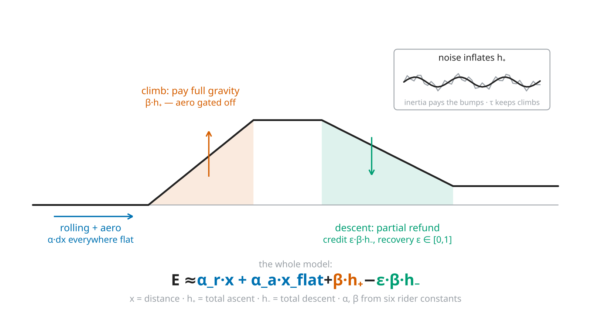

<!--
Substack series "A conta dos quilojaules", part 1 of 4 (pt-BR), ~11 min read.
LLM-assisted draft rewritten from research/article/paper1-closed-form.md
(sections 1-3) for a general audience; part 2 carries the rest of paper 1.
Per mission-model/08 (governance), post-freeze text meant for readers is
human-written: treat this as a pre-draft for the human authors/editors.

Number provenance (a moved number must be updated here too):
- held-out F3 3.24% / +0.07, F4 2.86%, F_base 3.19%, and the 3.24 CI
  [2.75, 3.50]: data/results/e52_summary.csv + lab journal Entry 57. Sign test:
  the current harness gives the closed form 153/305 (Entry 57 recorded 152, p = 1.00
  either way).
  Paper 1 printed the pre-Entry-57 values (3.39 / 3.05 / 149 of 305) until
  2026-09-25, when it and the 3q gate (now held to the printed digit) were fixed.
- the held-out half was re-scored in Entries 52, 55 and 57 as the per-ride
  physics estimators changed (Entry 55 adopted the drag estimator partly on it;
  Entry 64: "a cleaner claim needs ... new rides") -- hence the caveat below.
- eps 0.683 (F1) -> 0.294 (F3), tau 6 m, F4's fitted pair c 1.10 / eps 0.409:
  e52_split.csv. F4's climbing share comes from each ride's profile.
- 19% first contact (median), ~20% of ascent from sub-3 m swings, 2,535
  sustained climbs at 96% aggregate: journal Entries 2, 5 and 7 (the 44
  brevets, now outside the evaluated population).
- 3 m/km: paper 1 section 2.5 (raw barometric, 2 m convention); paper 2 re-measured
  3.01 on D3-D5. The fitted c = 1.10 is the (eps, c) pairing, not platform
  pre-smoothing (paper 1 section 2.5 and the Entry 52 note, corrected 2026-09-25).
- the "too good to be true" episode: paper 1 section 3.1.3 (Entry 55).
- kJ scale and the 400 kJ rule: the published Simujaules post.
Substack notes: no native tables; display equations go in Substack LaTeX
blocks; inline math is written in words or Unicode (no underscores); the
placeholder figure is research/article/figs/fig9-anatomy.svg rendered to PNG
(English labels, to be redrawn in Portuguese).
-->

# Uma conta de padaria para a energia de um pedal

*Testamos a fórmula de quilojaules do Pedal Hidrográfico em 2.039 pedais gravados com medidor de potência. Ela erra tão pouco quanto uma simulação física completa, e cabe na calculadora do celular.*

*Parte 1 de 4 da série “A conta dos quilojaules”, sobre o modelo de energia por trás do [Simujaules](https://pedalhidro.substack.com/p/simujaules) e da [Calculadora de Quilojaules](https://docs.google.com/spreadsheets/d/1KHL5LDVhEZWjsF2maByqghRyA-R6kn69VzeNf_f3dR4/edit?gid=0#gid=0).*

Todo chamado do Pedal Hidrográfico, o convite que o coletivo espalha para cada passeio, vem com uma estimativa em quilojaules, nosso jeito carinhoso de dizer quilojoules (kJ). É com ela que decidimos se o passeio cabe na noite (a regra dos 400 kJ, pensada para que ninguém perca o último trem, contada [no texto sobre o Simujaules](https://pedalhidro.substack.com/p/simujaules)) e que avisamos quem vem sobre o esforço:

- “de boa”: até 150 kJ;
- “OK”: de 150 a 300 kJ;
- “endorfinado”: de 300 a 500 kJ;
- “fritasso”: de 500 a 1.000 kJ;
- “insano”: acima de 1.000 kJ.

A estimativa sai de uma conta curta, dessas que se fazem no guardanapo da padaria. Por muito tempo a usamos sem saber quanto ela acertava. Então fomos conferir se ela fecha com a energia que as pessoas de fato gastam, usando a potência que cada uma fez em cada pedal. Em 305 pedais que ficaram fora do ajuste, metade das estimativas errou por menos de 3,2%, para mais ou para menos. Uma simulação física completa, que refaz o pedal metro a metro no computador, teve praticamente o mesmo erro. E uma versão ainda mais simples da conta, que dispensa o perfil de altitude e usa os totais de distância, subida e descida, se saiu tão bem quanto.

## Andar, subir, descer

Pedalar gasta energia por três motivos, e a fórmula tem um termo para cada um.

O primeiro é andar. A cada metro, os pneus perdem um pouco de energia contra o chão e o corpo tem de abrir caminho no ar. Esse custo por metro percorrido se chama α (alfa). A parte do ar cresce depressa com a velocidade, e dobrar a velocidade quadruplica a força que o ar faz contra quem pedala.

O segundo é subir. Cada metro de subida exige levantar o próprio peso, mais o da bicicleta e o da carga, contra a gravidade. Esse custo por metro subido é o β (beta).

O terceiro é descer, e aqui a conta se inverte. Na descida, a gravidade empurra a bicicleta, e a pessoa pode deixar de pedalar num trecho que, no plano, custaria energia. A fração do custo da subida que volta desse jeito é o ε (épsilon), que chamamos de fator de recuperação em descida.

Juntando os três:

$$E \approx \alpha\,x + \beta\,(h_+ - \varepsilon\,h_-)$$

Nela, x é a distância, h₊ é a subida acumulada (o “ganho de elevação” dos aplicativos) e h₋ é a descida acumulada, tudo em metros. A energia E sai em joules; dividida por mil, em quilojaules.

Os dois primeiros termos são física clássica, validada há décadas.[^martin] O α depende da massa, dos pneus, do tamanho da pessoa diante do vento e da velocidade; o β, só da massa e da gravidade.[^taxas] O terceiro é a novidade, um único número para a rota inteira que diz quanto das descidas vira avanço de graça. Ele é o assunto da parte 2.

*[Figura provisória, com rótulos em inglês.] A fórmula sobre um perfil de rota. Pneus e ar são pagos ao longo da distância (azul); a subida é paga inteira, sem cobrança de ar (laranja); a descida devolve a fração ε (verde).*

## Primeiro contato: 19% a mais

Na primeira comparação com medições reais, em 44 pedais longos de Danilo, um dos fundadores do coletivo, a fórmula cobrava, na mediana, 19% a mais do que a energia medida. Dois defeitos explicavam quase tudo.

### O ar nas subidas

A fórmula cobrava a resistência do ar na velocidade de cruzeiro no plano. Só que ninguém sobe ladeira a 25 km/h. Na subida a velocidade despenca, e o ar quase não pesa.

O conserto foi cobrar o ar só onde a inclinação fica abaixo de 2%, ou seja, no plano e nas descidas. O atrito dos pneus continua valendo na distância toda. Só isso cortou o erro pela metade.

### A subida que o barômetro inventa

O segundo defeito estava nos dados. O ciclocomputador mede a altitude com um barômetro, e a leitura oscila o tempo todo, alguns decímetros para cima e para baixo, a cada rajada ou mudança de velocidade. Na soma da subida, cada oscilação para cima conta como se fosse subida de verdade. Nos pedais longos de Danilo, uns 20% da subida registrada vinham de oscilações de menos de 3 metros.

O conserto é um filtro que funciona como uma folga: a altitude filtrada só se mexe quando a leitura se afasta dela mais do que um certo limiar, e os vaivéns que cabem dentro da folga somem da soma. O limiar que melhor se ajustou aos dados foi de 6 metros. Ele elimina o tremor do instrumento e também as subidinhas curtas, que se vencem no embalo da descida anterior (a parte 4 volta a elas).

Quem tem só os totais de subida e descida, sem o perfil, pode usar um atalho: descontar alguns metros de subida, e outros tantos de descida, para cada quilômetro rodado. Na altitude crua de um barômetro, são uns 3 metros por quilômetro; a parte 3 traz os valores de outras fontes.

### Dois sinais de que os consertos acertaram

O primeiro vem das subidas longas. Em 2.535 trechos de subida sustentada desses mesmos pedais, com 3% ou mais por pelo menos 100 m, a gravidade foi paga praticamente inteira: 96% no total. Quando a conta parece dar desconto nas subidas, a origem é o tremor do barômetro ou as subidinhas, e o filtro tira os dois.

O segundo vem do ε, que é ajustado aos dados. Sem os consertos, para fechar a conta ele precisa chegar a 0,68, o que significa devolver 68% de cada descida, um reembolso inflado que compensa o que foi cobrado a mais nas subidas. Com os dois consertos, o ε cai para 0,29. Quando um número ajustado precisa de um valor exagerado, está tapando o buraco de outro termo; consertados os buracos, ele volta a um valor modesto.

Com os consertos, a fórmula fica assim:

$$E \approx \alpha_r\,x + \alpha_a\,x_{\text{plano}} + \beta\,(\tilde h_+ - \varepsilon\,\tilde h_-)$$

Agora o primeiro termo é só o dos pneus, cobrado na distância toda; o segundo é o do ar, cobrado só na distância fora das subidas; e o til sobre h₊ e h₋ indica que a subida e a descida já passaram pelo filtro.

## O teste

### Os pedais

Juntamos 2.039 pedais de sete pessoas, todos gravados com medidor de potência. O medidor registra, segundo a segundo, a potência que as pernas fazem na pedivela. Somada do início ao fim do percurso, ela dá a energia que as pernas de fato entregaram. É o gabarito com que a fórmula é comparada.

Três dessas pessoas pedalam em São Paulo e arredores: dois ciclistas de fora do coletivo, que nos cederam seus históricos completos (dos quais 441 e 219 pedais passaram nos nossos critérios), e Danilo (636). As outras quatro são ciclistas europeus de um conjunto de dados aberto, com 743 pedais pela Catalunha, pela Borgonha e pelos Alpes franceses.[^europa]

Há de tudo: pedal urbano de anda-e-para, brevet (prova de longa distância) de 200 km, estrada de terra, chuva e vento. Só entraram pedais com pelo menos 20 km e com o medidor funcionando.

### As constantes de cada pedal

Além da rota, a fórmula precisa de três números físicos por pedal: a massa, o atrito dos pneus e o arrasto do ar. Em vez de perguntar a cada ciclista, tiramos esses números do próprio registro. O arrasto sai dos trechos planos, onde domina o ar, e pôde ser medido em quase todos os pedais. A massa sai das subidas longas, onde domina a gravidade. Como muitos pedais não têm subidas boas o bastante para separar a massa do atrito dos pneus, nesses usamos a mediana da própria pessoa.

### O envelope lacrado

Antes de ajustar qualquer coisa, sorteamos 15% dos pedais de cada pessoa, 305 ao todo, e os guardamos como num envelope lacrado. Com os outros 1.734, escolhemos entre quatro versões da fórmula (com e sem cada conserto) e ajustamos os dois números que vêm dos dados, o ε e o limiar do filtro.[^cv] O envelope não entrou em nenhuma dessas escolhas.

Uma fórmula testada nos mesmos dados em que foi ajustada sempre parece melhor do que é, e o envelope mostra como ela se sai em pedais que não ajudaram a construí-la. Uma ressalva: ele foi reaberto algumas vezes enquanto melhorávamos o jeito de tirar massa e arrasto de cada pedal, então uma prova limpa de verdade vai pedir pedais novos.

### O resultado

Usamos duas medidas ao longo da série. O erro mediano diz quanto a fórmula costuma errar, e metade dos pedais erra menos do que ele. O viés diz para que lado ela costuma errar. É positivo quando a conta cobra a mais, e negativo quando cobra a menos.

Nos 305 pedais do envelope, o erro mediano foi de 3,2%, e o viés ficou praticamente em zero.[^ic] A versão do atalho, só com os totais, teve erro mediano de 2,9%.[^atalho] A diferença entre as duas versões é menor que a incerteza do teste, então vale usar a que os seus dados permitirem.

## Empate com a simulação

Para ter uma régua, rodamos nos mesmos pedais uma simulação física completa, do tipo usado em ciência do esporte,[^martin] com as mesmas constantes de cada pedal. Ela refaz o percurso metro a metro e calcula a velocidade em cada ponto a partir da velocidade no ponto anterior. Sabe muito mais sobre o pedal do que a fórmula, que só olha totais.

A simulação teve praticamente o mesmo erro mediano, 3,2%. Na comparação pedal a pedal, a fórmula chegou mais perto da energia medida em 153 pedais, e a simulação em 152. Tudo o que a simulação sabe a mais não se converteu em acerto.

Numa versão anterior do teste, a fórmula parecia ganhar da simulação com folga. Era bom demais para ser verdade, e fomos atrás. O defeito estava num dado de entrada: o arrasto do ar tinha sido estimado numa velocidade e aplicado em outra. Corrigida essa estimativa, sem mexer em nada da simulação, a vantagem sumiu e virou o empate de hoje.

Por causa desse empate, uma conta que cabe numa planilha, e que um computador faz milhões de vezes por segundo, não perde nada para a simulação. É isso que permite ao Simujaules procurar caminhos pela energia, e a qualquer pessoa conferir um chamado com a calculadora do celular.

## O que o teste não mostra

- O teste mede se a conta fecha quando já se sabem a rota e o ritmo de quem pedalou: usamos a potência que cada pessoa de fato fez e as constantes tiradas do próprio pedal. Acertar um chamado antes do pedal, com a potência ainda no palpite, é outro teste, que ainda está por fazer.
- Dos pedais do envelope, 82% tinham um “irmão” entre os usados no ajuste: mesma pessoa, com distância e subida parecidas. Numa rota nova de verdade, conte com um erro um pouco maior.
- São sete pessoas, todas em bicicleta de estrada com medidor de potência. Bicicletas cargueiras, elétricas ou reclinadas podem se comportar de outro jeito; não as testamos.
- O vento ficou de fora: em todos os testes, ele entrou como zero.

## Para conferir e usar

O código, os testes e o diário de laboratório estão abertos em [github.com/pedalhidro/bicycling-energy-model](https://github.com/pedalhidro/bicycling-energy-model). O diário tem mais de setenta entradas, incluindo as hipóteses que deram errado, e há uma [versão dele contada como história](https://github.com/pedalhidro/bicycling-energy-model/blob/main/research/journal/CURATED_JOURNAL.md), em inglês. Os trajetos e os dados pessoais dos ciclistas ficam privados.

Para usar a fórmula agora mesmo, a [Calculadora de Quilojaules](https://docs.google.com/spreadsheets/d/1KHL5LDVhEZWjsF2maByqghRyA-R6kn69VzeNf_f3dR4/edit?gid=0#gid=0) faz a conta numa planilha aberta.

Na parte 2: o que a descida devolve, e a receita passo a passo para fazer a conta à mão.

[^martin]: MARTIN, J. C. et al. Validation of a Mathematical Model for Road Cycling Power. *Journal of Applied Biomechanics*, v. 14, n. 3, p. 276–291, 1998.

[^taxas]: α = (Crr·m·g + ½·ρ·CdA·v²) / k; β = m·g / k. Aqui m é a massa de tudo que se move (pessoa, bicicleta e carga), g a gravidade, Crr o coeficiente de resistência ao rolamento dos pneus, ρ a densidade do ar, CdA a área frontal efetiva, v a velocidade de cruzeiro no plano e k = 0,98 a eficiência da transmissão (a corrente come uns 2%). Usamos a gravidade medida em São Paulo pelo IAG-USP, 9,7864 m/s², e não os 9,81 dos livros. A parte 2 traz a receita com esses termos.

[^europa]: Conjunto *scikit-cycling* (quatro ciclistas, 2012 a 2015), licença CC BY 4.0, DOI [10.5281/zenodo.1202440](https://doi.org/10.5281/zenodo.1202440). Como os trajetos começam na casa das pessoas, não publicamos nenhuma geometria tirada deles.

[^cv]: Com validação cruzada: os 1.734 pedais foram divididos em cinco grupos; ajusta-se em quatro e testa-se no quinto, em rodízio, e o processo se repete quatro vezes. A versão escolhida, com perfil filtrado e ar só fora das subidas, venceu por esse critério e também pelo critério de informação de Akaike.

[^ic]: Intervalo de confiança de 95% (bootstrap) para o erro mediano: de 2,8% a 3,5%. O viés foi de +0,07%.

[^atalho]: Nessa versão, a fração da rota em subida veio do perfil, e o desconto de altitude e o ε foram ajustados juntos aos dados, em 1,1 m/km e 0,41. Os dois andam em par: um desconto menor pede um reembolso maior. A receita da parte 2 usa outro par, com valores típicos.

---

*[Créditos: autoria, edição e revisão. Declaração de uso de IA, se for o caso.]*

*Agradecemos a Pedro Pazello e a José Arcuri Martins pela doação dos seus históricos de pedal, e a todo o coletivo do [Pedal Hidrográfico](https://pedalhidrografi.co).*
