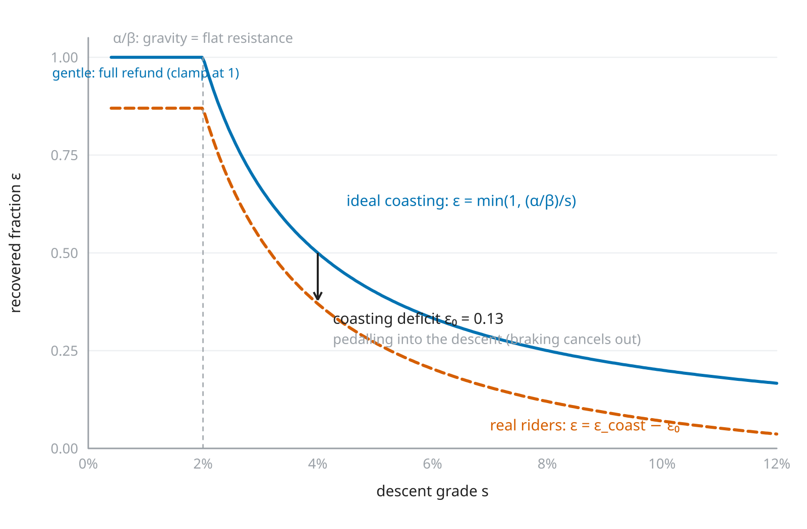

<!--
Substack series "A conta dos quilojaules", part 2 of 4 (pt-BR), ~11 min read.
LLM-assisted draft rewritten from research/article/paper1-closed-form.md
(sections 3.1.5, 3.2, 4.1.2, 4.4.2, Appendix A.5-A.6) for a general audience.
Per mission-model/08 (governance), post-freeze text meant for readers is
human-written: treat this as a pre-draft for the human authors/editors.

Number provenance (a moved number must be updated here too):
- eps 0.294: e52_split.csv.
- rider transfer: e54_transfer.csv -- 6 donors x 5 recipients (the fourth
  European has too few held-out rides); pooled median +0.047 pp; the two
  high-eps European donors cost their recipients a median +1.24 / +1.13 pp.
- regional 0.24 / 0.37, the opposite-sign biases, and "selecting tau per region
  buys 0.03 / 0.12 pp": e60_regional.csv (arms A-C). These eps are F3 values;
  F4's regional pair differs (0.431 / 0.370), hence the recipe's caveat.
- terrain vs people: Entry 61 -- registered pass 94%, fuller grid +0.161 vs
  +0.133 measured; the synthetic rider never stops.
- ceiling s*/s with s* ~ 2% (1.8-2.2%), deficit median 0.13 across the seven
  riders (0.08-0.30, positive for all): paper 1 eq. (6), section 4.4.2;
  braking: Appendix A.6; stops destroy the refund in transit: section 4.4.2.
- Sobol 7% and the tolerance list: paper 1 Tables 5-6 (e50, e58). alpha = P/v:
  paper 1 section 4.1.2's pairing caution and section 3.2.
- recipe, anchors and worked example: paper 1 section 4.1.2; the 21% climbing
  share is the median D5 ride.
Substack notes: no native tables; inline math in words or Unicode; the placeholder
figure is research/article/figs/fig10-coasting-deficit.svg rendered to PNG
(English labels, to be redrawn in Portuguese).
-->

# O que a descida devolve

*A fórmula de quilojaules tem um número que não encontramos medido em nenhum outro trabalho: quanto uma descida devolve do que a subida cobrou. Mostramos quanto ele vale, por que muda de São Paulo para os Alpes, e como fazer a conta inteira à mão.*

*Parte 2 de 4 da série “A conta dos quilojaules”. A [parte 1](LINK-PARTE-1) apresenta a fórmula e o teste com 2.039 pedais.*

Na parte 1, testamos uma fórmula de três termos para a energia de um pedal: um custo por metro andado, um custo por metro subido e um reembolso por metro descido. Nos pedais guardados para o teste, ela errou tão pouco quanto uma simulação física completa, e metade das estimativas errou por menos de 3,2%.

Os dois primeiros termos são física conhecida. O terceiro, o fator de recuperação em descida, ε, é a novidade. Ele depende mais da paisagem do que de quem pedala, e errar o seu valor custa pouco, duas propriedades que tornam a fórmula prática.

## O reembolso

Numa descida, a gravidade empurra a bicicleta e paga o atrito dos pneus e a resistência do ar do trecho, e a pessoa pode parar de pedalar. A energia que ela deixa de gastar é o reembolso. O ε mede esse reembolso como fração do que custou subir a mesma altura. Com ε = 1, cada metro descido devolveria tudo; com ε = 0, nada.

Nos 1.734 pedais usados no ajuste da parte 1, o ε ficou em 0,29. As descidas devolveram 29% do custo da subida equivalente.

É pouco por dois motivos. Numa descida íngreme, a gravidade oferece mais do que dá para aproveitar, e o excesso se perde no arrasto do ar ou no freio. E muita gente continua pedalando na descida.

## Depende de quem pedala?

Essa era a pergunta mais importante de todo o trabalho. Se cada pessoa tivesse o seu próprio ε, a fórmula exigiria uma calibração individual antes de ser usada.

O teste foi assim: ajustar o ε usando os pedais de uma única pessoa e aplicar esse valor nos pedais das outras. Fizemos isso com seis das sete pessoas (a sétima tinha só dois pedais no envelope). Na mediana de todas as combinações, o erro subiu 0,05 ponto percentual: um erro de 3,20% viraria 3,25%.

Nem toda combinação foi tão boa. O ε dos dois europeus que mais aproveitam as descidas custou, em geral, pouco mais de um ponto aos outros. Na maioria dos casos, porém, o ε de uma pessoa serve para as outras.

## Depende de onde se pedala

Entre paisagens, o ε muda. Ajustado separadamente, ele fica em 0,24 nos pedais de São Paulo e em 0,37 nos europeus. Em São Paulo, as descidas são curtas e logo emendam num plano ou noutra subida; nos Alpes e na Catalunha, são longas e contínuas, e é nelas que se aproveita melhor o que a gravidade oferece.

Usar um valor único para as duas regiões custa quase um ponto percentual de erro, e em direções opostas, porque a fórmula passa a cobrar a menos em São Paulo e a mais na Europa. Deixar o resto da fórmula, inclusive o limiar do filtro, variar por região melhora quase nada (0,03 e 0,12 ponto). Basta mudar o ε.

## Relevo ou gente?

Os ciclistas europeus são outras pessoas, então a diferença poderia vir delas, de jeitos diferentes de descer, de frear, de pedalar.

Para separar as duas explicações, usamos a simulação da parte 1 com um único ciclista virtual, sempre com o mesmo comportamento, percorrendo as rotas reais das duas regiões. Se a diferença viesse das pessoas, ela sumiria, porque o ciclista agora é o mesmo. Ela reapareceu inteira: na versão mais completa da simulação, ficou até um pouco maior do que a medida nos ciclistas reais. E o ciclista virtual não para em semáforo nenhum. Quem muda o ε é o relevo.

## Um teto e um hábito

Imagine alguém que desce sem pedalar nada. O máximo que a descida pode lhe devolver é o custo de rodar aquele mesmo trecho no plano, porque é isso que a pessoa deixou de pedalar. Numa descida suave, a gravidade mal dá conta desse custo, e todo o empurrão vira economia. Numa descida íngreme, ela oferece muito mais do que o plano custaria, e o excesso vira velocidade, arrasto do ar e freio.

Esse teto tem uma conta simples. Existe uma inclinação de equilíbrio, perto de 2%, em que a gravidade paga exatamente o custo de andar no plano. O teto é essa inclinação dividida pela inclinação da descida. Numa descida de 4%, o teto é metade; numa de 8%, um quarto. Ele não tem nenhum número ajustado: sai da inclinação e da física de quem pedala (massa, arrasto e velocidade no plano).

Os ciclistas reais ficam abaixo do teto porque continuam pedalando um pouco na descida, gastando energia onde a gravidade já estava pagando. Essa distância até o teto, o hábito de pedalar na descida, apareceu nos sete ciclistas. Ela varia de pessoa para pessoa e em geral fica perto de 0,13. Numa descida de 8%, com teto de 0,25, o ciclista típico recupera uns 0,12. É assim que o Simujaules calcula o ε de cada trecho, o teto daquela inclinação menos 0,13 (a parte 4 mostra como isso se sai).

Frear para segurar a velocidade durante a descida não diminui o ε. O freio só queima o excesso acima do teto, e quem freia continua sem pedalar. O que custa é parar no pé da ladeira: o embalo que a descida ia devolver no trecho seguinte vai embora no freio, e por isso descidas interrompidas devolvem menos.

*[Figura provisória, com rótulos em inglês.] O teto de quem desce sem pedalar (linha contínua) e o que o ciclista típico recupera, o teto menos 0,13 (linha tracejada), conforme a inclinação da descida.*

## O que mais pesa no erro

A boa notícia é que errar o ε custa pouco. Medimos quanto cada número fornecido pelo usuário contribui para o erro final: o arrasto do ar e a massa carregam quase tudo, e o ε responde por 7%.[^sobol]

Em termos práticos, quanto se pode errar cada número antes de o erro da fórmula ficar 50% maior:

- arrasto do ar (CdA): uns 10% para cada lado;
- atrito dos pneus (Crr): uns 17%;
- massa: uns 25%;
- ε: pode ser até quatro vezes menor, ou quase o dobro.

Por isso, antes de tudo, suba na balança com a bicicleta. E, se tiver medidor de potência, meça a potência e a velocidade num mesmo trecho plano: a resistência no plano, pneus mais ar, é a potência dividida pela velocidade, e isso dispensa chutar o arrasto. É justamente essa soma que os dados determinam bem, e melhorar a estimativa de só uma das partes pode até piorar a conta. Sem medidor, saiba ao menos a sua velocidade no plano. O ε pode sair da lista da receita.

## A receita

Para fazer a conta à mão, bastam os totais de distância, subida e descida (do ciclocomputador ou de um site de rotas; veja o passo 3), a sua massa somada à da bicicleta e a sua velocidade ou potência no plano.

1. **Calcule os custos por metro**, em joules por metro. Valores típicos: Crr = 0,008 para o atrito dos pneus; CdA = 0,40 m² para a área frontal efetiva; ρ = 1,13 kg/m³ para a densidade do ar de São Paulo; k = 0,98 para a eficiência da transmissão; g = 9,79 m/s² para a gravidade.
    - pneus: Crr × m × g ÷ k
    - ar: ½ × ρ × CdA × v² ÷ k, com a velocidade v em metros por segundo (km/h divididos por 3,6)
    - subida: β = m × g ÷ k

2. **Se você sabe a sua potência no plano**, e não a velocidade, v é a velocidade em que (pneus + ar) × v dá essa potência. Vá chutando; em duas ou três tentativas chega. Para 75 kg de pessoa e bicicleta:
    - 50 W: 16,6 km/h;
    - 100 W: 23,2 km/h;
    - 150 W: 27,6 km/h;
    - 200 W: 31,1 km/h.

    Use a potência que você sustenta num trecho plano, e não a média do pedal inteiro. Se você sabe as duas coisas, potência e velocidade no plano, há um atalho melhor: pneus + ar = potência ÷ velocidade (em watts e metros por segundo), e daí ar = potência ÷ velocidade − pneus.

3. **Corrija a altimetria.** Tire 3 m da subida e 3 m da descida para cada quilômetro de rota. Isso vale para a altitude crua de um ciclocomputador com barômetro; se os totais vieram de um mapa, o desconto é outro (parte 3).

4. **Escolha o ε**: 0,24 para o relevo de São Paulo; 0,20 para um pedal com muito anda-e-para, errando para o lado seguro (um reembolso menor deixa a estimativa um pouco mais alta); 0,37 para descidas longas de serra. Esses valores foram ajustados na versão da fórmula com perfil filtrado; na conta só com totais, são uma aproximação.

5. **Some**: energia = pneus × distância + ar × distância fora das subidas + β × subida − ε × β × descida. Se não souber quanto da rota é subida, conte 80% da distância como fora das subidas (o pedal mediano de Danilo passa 21% da distância subindo). Divida por 1.000 para ter kJ.

Os valores típicos descrevem uma pessoa típica. O erro de uns 3% da parte 1 foi medido com os números de cada ciclista; quanto mais os seus se afastarem dos típicos, maior o erro, na proporção da lista da seção anterior.

## Um exemplo

Imagine uma pessoa que, somada à bicicleta, pesa 75 kg e pedala a 50 W no plano. A rota é urbana: 25 km, com 200 m de subida e 200 m de descida gravados pelo ciclocomputador.

- Pneus: 0,008 × 75 × 9,79 ÷ 0,98 = 6,0 J/m.
- Subida: β = 75 × 9,79 ÷ 0,98 = 749 J/m.
- Ar: 50 W no plano dão 16,6 km/h, ou 4,6 m/s; daí, ar = 4,9 J/m.
- Altimetria corrigida: 200 − 3 × 25 = 125 m de subida, e o mesmo de descida.
- Pedal urbano, com muito anda-e-para: ε = 0,20.

Agora a soma:

- pneus, na distância toda: 6,0 J/m × 25.000 m = 150 kJ;
- ar, em 80% da rota: 4,9 J/m × 20.000 m = 98 kJ;
- subida: 749 J/m × 125 m = 94 kJ;
- reembolso da descida: 0,20 × 94 kJ = 19 kJ, que se subtrai.

Total: 150 + 98 + 94 − 19, uns 320 kJ. Na escala do coletivo, um passeio “endorfinado”.

Por uma coincidência feliz, cada kJ de trabalho na pedivela custa ao corpo cerca de 1 kcal de comida. Os músculos transformam uns 24% da energia do alimento em trabalho, e 1 kcal vale 4,184 kJ, então as duas coisas quase se cancelam. Os 320 kJ do exemplo pedem umas 320 kcal, mais ou menos um pão com manteiga e uma banana.

## E o vento?

Nos testes, o vento ficou de fora. Ele entra só no custo do ar, mas pesa ao quadrado. A 20 km/h, um vento contra de 10 km/h multiplica o custo do ar por 2,25, e o mesmo vento a favor o reduz a um quarto. Num bate-e-volta com vento, a volta a favor não compensa a ida contra.

Se você conhece o vento, some-o à velocidade dentro do custo do ar, trecho por trecho: positivo quando contra, negativo quando a favor. A correção sai da física, mas não foi testada.

## Para usar

A [Calculadora de Quilojaules](https://docs.google.com/spreadsheets/d/1KHL5LDVhEZWjsF2maByqghRyA-R6kn69VzeNf_f3dR4/edit?gid=0#gid=0) faz essa conta numa planilha aberta. O código e o diário de laboratório estão em [github.com/pedalhidro/bicycling-energy-model](https://github.com/pedalhidro/bicycling-energy-model).

Na parte 3: e quando a altitude vem de um mapa, e não de um barômetro?

[^sobol]: Uma decomposição de variância (índices de Sobol) sobre massa, arrasto, atrito dos pneus e ε, usando as faixas de valores que de fato observamos: arrasto 55%, massa 46%, pneus 14%, ε 7%. As fatias se sobrepõem porque os números interagem.

---

*[Créditos: autoria, edição e revisão. Declaração de uso de IA, se for o caso.]*

*Agradecemos a Pedro Pazello e a José Arcuri Martins pela doação dos seus históricos de pedal, e a todo o coletivo do [Pedal Hidrográfico](https://pedalhidrografi.co).*
