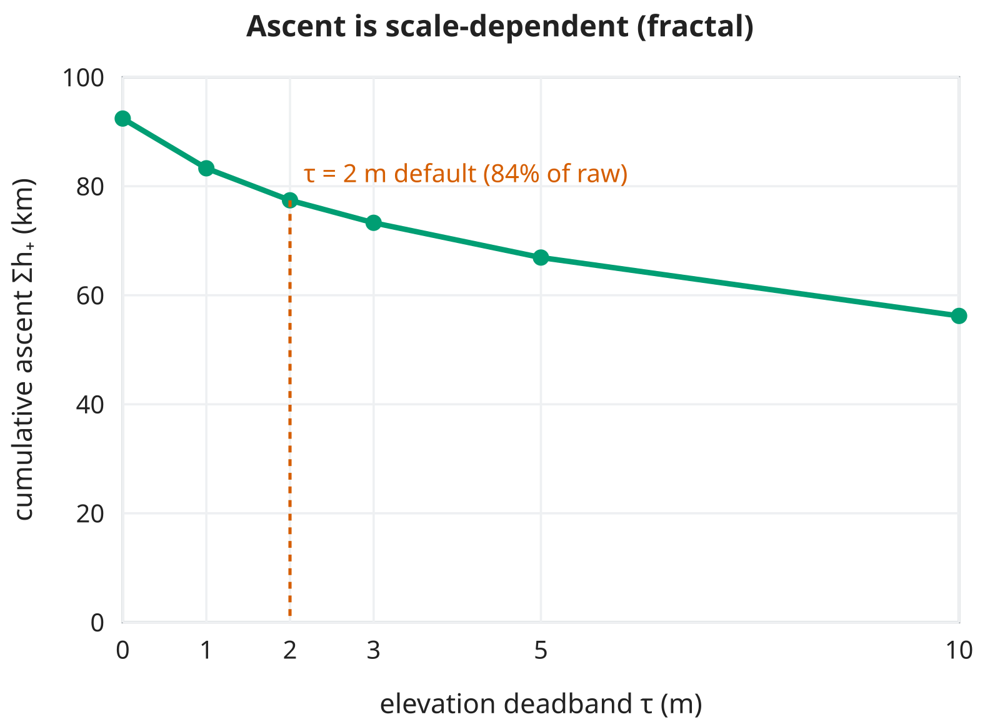

<!--
Substack series "A conta dos quilojaules", part 3 of 4 (pt-BR), ~11 min read.
LLM-assisted draft rewritten from research/article/paper2-dem-deployment.md
for a general audience. Per mission-model/08 (governance), post-freeze text
meant for readers is human-written: treat this as a pre-draft for the human
authors/editors.

Number provenance (a moved number must be updated here too):
- the substitution results, noise rates c per chain, travel-ride split, Europe
  column: paper 2 Tables 1-2 (lab journal Entries 41 and 71, gate 3j). eps_d is
  RECOMPUTED on each substituted profile (paper 2 section 2.1); only eps_0 is held.
- anomaly screen 5.3% -> 3.4% (FABDEM at 5 m, joint screen over all arms, 745 of
  1,117 rides clean, most jumps on the survey): paper 2 section 2.3, measured on
  the earlier five-corpus walk -- hence "num teste anterior".
- wrong c on FABDEM: +19.2% at 5 m, +7.4% at 30 m (journal Entry 41).
- bridge deck (-2.43 m bridges, -0.29 m tunnels), repairs-do-not-stack at route
  grain: paper 2 section 2.3. Profile smoothing vs raster smoothing validated at
  sigma = 10 m only (-1.1% median).
- FABDEM vs 5 m survey ascent (+101-135% on the flattest corpora): Entries 6
  and 19 as cited in paper 2 section 1.2. FABDEM MAE 1.12 m: Hawker et al. 2022.
- Contornar Anhangabaú (440 / 602 / 449 / 689 / 575 m; +8.7 / 0.0 / +8.7 /
  +4.5%; F4 at c = 3: +13.9 / +19.8%): paper 2 section 4. NB it is also D5#216,
  inside paper 1's training half, so this post makes no "not fitted" claim
  (paper 2 section 4 says so since 2026-09-25).
- barometer 3.8% here vs 3.2% in part 1: part 1 pools European rides; its SP
  held-out rides alone read 3.67% (e60_regional.csv, arm A).
- placeholder figure: research/article/figs/fig3-ascent-fractal.svg rendered to
  PNG (English labels; data are the 44 D1 brevets, make_figures.py fig3).
-->

# A subida que o mapa inventa

*Ninguém planeja passeio com barômetro. Medimos quanto a conta de quilojaules perde quando a altitude vem de um mapa de relevo, e montamos uma receita para cada tipo de mapa.*

*Parte 3 de 4 da série “A conta dos quilojaules”. As partes [1](LINK-PARTE-1) e [2](LINK-PARTE-2) apresentam a fórmula, o teste com 2.039 pedais e a receita.*

Nas partes 1 e 2, a fórmula foi testada com a altitude que o próprio ciclocomputador gravou durante o pedal. Na hora de montar o chamado, porém, o pedal ainda não aconteceu. O que se tem é uma linha desenhada no mapa e um modelo digital de terreno: uma grade que guarda a altitude de cada pedacinho de chão. É desse tipo de mapa que vêm os números de subida de qualquer site de rotas, e é nele que o Simujaules faz as suas contas.

*Contornar Anhangabaú*, um pedal hidrográfico pelo centro de São Paulo (o Anhangabaú é um dos rios enterrados da cidade), mostra o que pode acontecer. O barômetro registrou 440 m de subida. Ao longo do mesmo trajeto, o mapa de 5 m da cidade enxerga 602 m, 37% a mais, e com isso a estimativa de energia fica 8,7% acima do que o medidor de potência registrou. Com o perfil suavizado, o mesmo mapa volta a 449 m de subida, e a estimativa acerta os 643 kJ do pedal. Acertar em cheio foi sorte. O típico, com esse mapa bem tratado, é errar uns 4%.

Refizemos a comparação em 1.164 pedais dos três ciclistas de São Paulo e em 670 dos europeus. Com um mapa bem tratado, trocar o barômetro pelo mapa custa pouco. Com o mapa de 5 m de São Paulo, o erro mediano (metade dos pedais erra menos do que ele) vai de 3,8% para 4,0%.[^controle] Com o FABDEM, o melhor mapa de relevo gratuito do planeta, vai para 4,5%. Nos pedais europeus, que não participaram de nenhuma escolha da receita, o FABDEM errou 4,1%, contra 3,4% do barômetro.

## Quanto sobe uma subida?

A subida acumulada de uma rota não tem um valor verdadeiro. Quanto mais curto o intervalo entre as leituras de altitude, mais subida aparece: cada lombada, cada meio-fio e cada tremor do instrumento entra na soma, e o total nunca se estabiliza. O mesmo acontece com o litoral de um país, que fica mais comprido quanto menor a régua usada para medi-lo.[^rapaport]

*[Figura provisória, com rótulos em inglês.] A subida total somada de 44 pedais longos, conforme a folga do filtro da parte 1: 92 km sem filtro, 77 km com folga de 2 m e 56 km com folga de 10 m. Cada escala dá um total diferente.*

O FABDEM, por exemplo, erra em média só 1,1 m na altitude de cada ponto em áreas construídas.[^hawker] Somados ao longo de uma rota, porém, esses pequenos erros inflam muito a subida total. Nas rotas mais planas, o FABDEM chega a enxergar o dobro da subida que o mapa de 5 m enxerga.

Por isso o desconto de 3 metros por quilômetro das partes 1 e 2, medido em barômetros, não serve para um mapa. Cada fonte de altitude tem o seu ruído e pede o seu próprio desconto.

## O experimento

Os 1.164 pedais de São Paulo e os 670 europeus saíram dos conjuntos da parte 1, e são os que passaram pelos critérios de qualidade do trajeto e do mapa. Entre os de São Paulo estão 84 cicloviagens de Danilo, fora da cidade. Em cada pedal, trocamos uma coisa só: a altitude, que passou a vir do mapa, lida ao longo do trajeto que a pessoa de fato percorreu. Potência, massa, arrasto e o hábito de 0,13 ficaram iguais, e o ε de cada pedal foi recalculado a partir das descidas do novo perfil, como faz o Simujaules. Assim cada pedal serve de controle para si mesmo, e toda diferença de erro vem da fonte de altitude.

Usamos dois mapas:

- o levantamento da cidade de São Paulo feito com fotos aéreas em 2010, com pixel de 5 m, que só existe aqui;[^igc]
- o FABDEM, global e gratuito, com pixel de 30 m, feito com dados de radar de satélite dos quais se removeram prédios e árvores.[^hawker]

E mexemos nos dois botões que quem planeja controla:

- de quantos em quantos metros se lê a altitude ao longo da linha: a cada 5 ou a cada 30 m;
- se o perfil de altitude é alisado, trocando cada altitude por uma média das vizinhas, com mais peso para as mais próximas. A largura dessa vizinhança se chama σ (sigma).

## O que encontramos

### Mapa de São Paulo: suavizar

Sem tratamento, o mapa de 5 m quase não piora o erro, mas muda o viés, que diz para que lado a conta costuma errar. Com o barômetro, ele era de −1,9%; com o mapa, passa a +0,3%. A conta passa a cobrar subida demais, porque o mapa, com tanta resolução, enxerga relevo miúdo que o asfalto alisa e que ninguém sobe de verdade.

Com o perfil suavizado (σ = 30 m), o viés volta a −1,8%, o mesmo do barômetro, e o erro mediano fica em 4,0%, sem reajustar nada. E basta suavizar o perfil. Uma média sobre a lista de altitudes que você já tem dá o mesmo que suavizar o mapa inteiro (testamos com σ = 10 m, e a subida total difere 1% na mediana), sem baixar gigabytes de relevo.

### FABDEM: não ler fino demais

A troca pelo FABDEM custa de duas a quatro vezes mais do que a troca pelo mapa paulistano: 0,7 a 1,3 ponto a mais de erro, contra 0,3. Lido a cada 30 m, ele erra 4,5% e cobra 2,2% a mais. Lido a cada 5 m, fica pior, com 5,1% de erro e cobrando 4,3% a mais. Ler a cada 5 m um mapa de quadrados de 30 m obriga o computador a inventar altitudes entre um quadrado e outro, e numa linha diagonal isso fabrica relevo. A subida total chega a 2,4 vezes a do barômetro. No *Contornar Anhangabaú*, o FABDEM lido a cada 5 m enxerga 689 m de subida; lido a cada 30 m, 575 m.

### Defeitos, pontes e túneis

Os defeitos do mapa são fáceis de achar. Emendas entre blocos, falhas nos dados e estruturas que o algoritmo não conseguiu apagar aparecem todas do mesmo jeito: um salto de mais de 10 m de altitude em 5 m de distância, como uma rampa de 200%. Vale conferir o perfil da rota atrás desses saltos antes de confiar na conta. Num teste anterior, um pedal em cada três tinha um salto desses em algum dos mapas, a maioria no levantamento paulistano. Sem esses pedais, o erro do FABDEM lido a cada 5 m caiu de 5,3% para 3,4%, em parte porque a triagem tira justamente os pedais que um mapa de pixel grande lê mal.

O mapa de relevo também não sabe que existe ponte. Onde há um viaduto, ele desce até o fundo do vale e sobe de novo, e a conta cobra essa subida. Há dois consertos: trocar a altitude sob a ponte por uma reta, como se fosse a pista da ponte, ou deixar a suavização de 30 m achatar o vale estreito debaixo dela. Cada um funciona bem sozinho, mas, na conta do pedal inteiro, os dois juntos corrigem a mesma coisa duas vezes e pioram o resultado. (Na conta passo a passo do Simujaules, a história é outra; veja a parte 4.)

A reta tem ainda um defeito conhecido. Ponte de verdade tem corcova, que o ciclista sobe e a reta apaga. Nas pontes, isso deixa de cobrar uns 2,4 m de subida por pedal; nos túneis, quase nada, porque a pista passa mesmo reta por baixo do morro.

## Cada fonte, seu desconto

Para quem tem só os totais de distância, subida e descida, como na Calculadora de Quilojaules, o desconto de subida fantasma muda com a fonte. Medimos, para cada uma, quantos metros de subida fantasma aparecem por quilômetro de rota:

- barômetro do ciclocomputador, em São Paulo: 3,0 m/km;
- barômetros dos ciclistas europeus: 1,3 m/km, com aparelhos menos ruidosos e terreno com menos vaivéns;
- mapa de 5 m de São Paulo, sem suavizar: 4,9 m/km;
- FABDEM lido a cada 30 m: 7,4 m/km em São Paulo e 5,6 na Europa;
- FABDEM lido a cada 5 m: 10,2 m/km.

Usar o desconto do barômetro, 3 m/km, num total tirado do FABDEM lido a cada 5 m deixa a conta 19% acima do real; lido a cada 30 m, uns 7% acima. No *Contornar Anhangabaú*, o mesmo erro deixaria a estimativa 13,9% acima com o mapa de 5 m e 19,8% acima com o FABDEM lido a cada 5 m.

## A receita

Com o perfil de altitude da rota (a lista de altitudes ao longo dela), procure a sua fonte:

- **barômetro do ciclocomputador**: nenhum tratamento. Espere um erro mediano de uns 3,8%.
- **mapa de 5 m de São Paulo**: leia a altitude a cada 5 m e suavize o perfil com σ = 30 m. Espere 4,0%.
- **FABDEM**: leia a altitude a cada 30 m, nunca mais fino. Espere 4,5% em São Paulo e 4,1% na Europa, com a conta cobrando de 2% a 3% a mais.

Em todos os casos, depois do tratamento, passe o filtro da parte 1 com uma folga de 2 m, que foi a configuração destes testes. As faixas de erro foram medidas com a potência real de cada pedal e com o ε calculado pela inclinação.

Com só os totais, desconte a subida fantasma da fonte de onde eles vieram, pela lista acima. É um remendo: funciona bem nas fontes mais ruidosas e tende a descontar demais nas mais limpas.

## Limites

- Lemos o mapa ao longo do trajeto gravado, e não da linha que um site de rotas desenharia. A diferença entre as duas linhas soma outro erro, que medimos separadamente e que não entra nestes números.
- Vale o aviso da parte 1: os testes usam a potência real de cada pedal. O que se mede é se a contabilidade fecha, e não a capacidade de prever um pedal.
- O terreno pesa. Nas cicloviagens de Danilo, em terreno mais acidentado e fora da área do mapa paulistano, o FABDEM lido a cada 5 m errou 7,7%, contra 4,7% do barômetro da mesma pessoa, no mesmo aparelho. Em terreno acidentado, planeje com mais margem.
- Os mapas envelhecem. O levantamento de São Paulo é de 2010, e o FABDEM vem de dados de radar de 2011 a 2015; viaduto novo não aparece em nenhum dos dois.
- São duas regiões, dois mapas e sete ciclistas; na Europa, testamos só o FABDEM. Os descontos da receita valem para essas fontes. Para outra fonte, o caminho é medir o desconto dela em alguns pedais gravados: a subida bruta menos a filtrada, dividida pela distância.

O código deste teste está no mesmo repositório das outras partes, [github.com/pedalhidro/bicycling-energy-model](https://github.com/pedalhidro/bicycling-energy-model).

Na parte 4: como a fórmula funciona dentro do Simujaules, dividida em passos.

[^controle]: Com o barômetro, a conta erra aqui 3,8%, e não os 3,2% da parte 1, principalmente porque só entram pedais de São Paulo: no envelope da parte 1, os de São Paulo sozinhos já erravam 3,7%. Além disso, a configuração é outra, a que o Simujaules usa para a energia de uma rota traçada: filtro com folga de 2 m, e não os 6 m da parte 1, e ε calculado a partir da inclinação das descidas da rota (o teto menos 0,13, da parte 2). O que interessa aqui é a comparação entre as fontes de altitude, com todo o resto fixo.

[^rapaport]: RAPAPORT, D. C. Evaluating cumulative ascent: Mountain biking meets Mandelbrot. *International Journal of Modern Physics C*, v. 22, n. 3, p. 209–217, 2011.

[^hawker]: HAWKER, L. et al. A 30 m global map of elevation with forests and buildings removed. *Environmental Research Letters*, v. 17, 024016, 2022.

[^igc]: Levantamento do Instituto Geográfico e Cartográfico do Estado de São Paulo (IGC-SP), 2010. O mapa não é redistribuído no repositório.

---

*[Créditos: autoria, edição e revisão. Declaração de uso de IA, se for o caso.]*

*Agradecemos a Pedro Pazello e a José Arcuri Martins pela doação dos seus históricos de pedal, e a todo o coletivo do [Pedal Hidrográfico](https://pedalhidrografi.co).*
