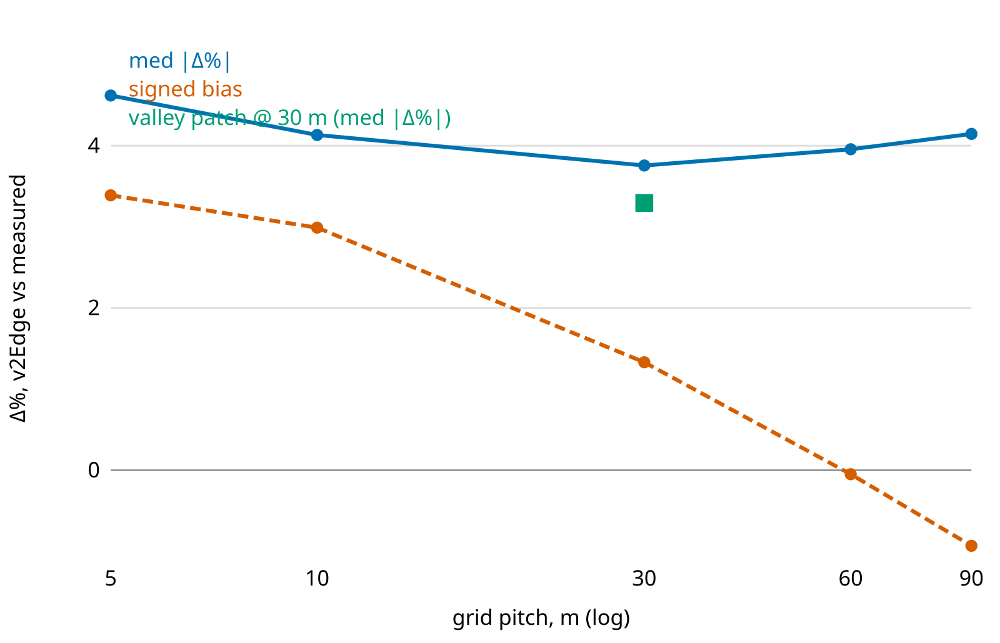
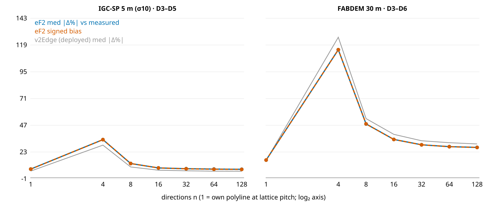

<!--
Substack series "A conta dos quilojaules", part 4 of 4 (pt-BR), ~11 min read.
LLM-assisted draft rewritten from research/article/paper3-edge-cost.md (the
measured sections 3.1-3.2) for a general audience. Paper 3 is a partial draft:
its route-divergence study (H3) is planned, and this post says so. Per
mission-model/08 (governance), post-freeze text meant for readers is
human-written: treat this as a pre-draft for the human authors/editors.

Number provenance (a moved number must be updated here too):
- the lattice is the raster's own pitch: ~5 m on the bundled IGC-SP DTMs
  (simujaules/dem/sampa_*.tif, 4.78e-5 deg), 30 m on FABDEM. Paper 3's "deployed
  30 m" is the calibration/FABDEM scale, which sigma = 30 m brings the 5 m map to.
- U-curve over the five tested pitches (4.6 / 3.8 / 4.1 at 5 / 30 / 90 m),
  whole-ride F4 on the same profiles 2.7 (f4_pub; held-out F4 2.86 from
  e52_summary.csv), valley patch 3.3% with bias -0.08 (from +1.33), median
  toll 20.3 m/ride: data/results/e72_edgegrain.csv (Entry 72; medians
  recomputed from the per-ride signed errors). The patch arm is a first look.
- placeholder figures: research/article/figs/fig-p3-scale.svg and fig-p3-dirs.svg
  rendered to PNG (English labels).
- direction ladder (+27% / +5.4% length at n = 4 / 8, ~1% at 16; raw FABDEM
  1.42x climb at n = 8), portals 802/880 (measured at n = 8), eps contest 3.31
  vs 10.24, default cell sigma30 n = 16 WITHOUT portals: 3.31 (+2.41) IGC and
  5.0486 (+3.34) FABDEM -> 5.0 (the Simujaules post's 5.1 double-rounds 5.05),
  n = 8 at 6.57 / 8.52, runtime 1.5-2.4x: paper 3 section 3.2 (e73_gridpath.csv,
  Entries 73-74).
- beta/alpha ~ 69 at 50 W; at 10 km/h ~96, capped at 1/Crr = 125 (paper 3
  section 1.1, corrected 2026-09-25). h_KE and the ~90 m recovery length:
  paper 1 sections 4.4.2 and 4.4.4.
- route-level beats per-step on the same paths: paper 3 section 3.2.2 (n = 8);
  the fact-check reproduced it at sigma30, n = 16 (F3 2.71 vs 3.31 IGC, 3.39 vs
  5.05 FABDEM, medians) -- stated qualitatively here.
- Simujaules v64 (2026-08-08) shipped sigma 30 on every source + 16
  directions: simujaules/CHANGELOG.md. The valley toll has not shipped.
-->

# Um passo de cada vez

*Para achar caminhos de menor energia, o Simujaules divide o mapa numa grade e dá um custo a cada passo entre vizinhos. Medimos quanto a conta perde nessa divisão, e qual configuração erra menos.*

*Parte 4 de 4 da série “A conta dos quilojaules”. As partes anteriores: [1](LINK-PARTE-1), [2](LINK-PARTE-2) e [3](LINK-PARTE-3).*

No [texto sobre o Simujaules](https://pedalhidro.substack.com/p/simujaules) mostramos o que ele faz: campos de energia, densidades de caminhos, fronteiras bicienergéticas. Aqui conferimos a conta que ele faz a cada passo e mostramos o que mudou nele depois disso.

## Por que traçar rotas pela energia

Para quem pedala a 50 W no plano, uns 17 km/h, um metro de subida custa tanto quanto 69 metros de chão plano. Subir a altura de um prédio de dez andares custa o mesmo que pedalar 2 km sem subir nada. Quem vai mais devagar sente a subida pesar ainda mais: a 10 km/h, a proporção passa de 95 para 1.

Por isso o caminho mais curto e o menos cansativo se separam onde há relevo. Um desvio de um quilômetro que evita 30 metros de subida pode sair mais barato do que ir reto. Para achar esses caminhos, o computador precisa saber quanto custa, em energia, cada passo possível.

## Um mapa de quadradinhos

A fórmula das partes anteriores olha o pedal inteiro. O Simujaules enxerga outra coisa: uma grade de quadradinhos do tamanho do pixel do mapa, cada um com a sua altitude. São quadradinhos de 5 m nos mapas de São Paulo e de 30 m no FABDEM. Um caminho é uma sequência de passos entre quadradinhos vizinhos, e cada passo precisa ter um custo que dependa só dele, como um pedágio cujo preço não depende de onde você veio. É isso que permite ao algoritmo de busca, o de Dijkstra,[^dijkstra] comparar milhões de caminhos.

Três peças da fórmula precisam ser adaptadas para caber num passo:

- a regra de cobrar o ar só fora das subidas, que na fórmula olha a rota inteira;
- o ε, que é um número só para a rota toda;
- o filtro de altitude, que percorre o perfil inteiro em sequência.

## O custo de um passo

As duas primeiras peças se adaptam no próprio custo do passo. Num passo de subida, com rampa de 2% ou mais, o Simujaules cobra os pneus e a gravidade, sem o ar. Num passo plano ou de subida suave, cobra pneus, ar e gravidade. Num passo de descida, cobra o que custaria o mesmo trecho no plano, menos o reembolso, e o custo nunca fica negativo.

O reembolso de cada passo depende da inclinação dele. É o teto da parte 2 menos o hábito de pedalar na descida, com piso em zero:

$$\varepsilon(s) = \max\!\left(0,\ \min\!\left(1,\ \frac{s_*}{s}\right) - 0{,}13\right)$$

Aqui, s é a inclinação da descida, e s* é a inclinação de equilíbrio, perto de 2%. Numa descida suave, volta quase tudo; numa íngreme, pouco.

O filtro não cabe num passo, e quem faz boa parte do trabalho dele é o próprio mapa, suavizado antes da busca, como na parte 3. O resto desse trabalho, as subidinhas vencidas no embalo, tem uma seção própria mais adiante.

## Primeiro teste: o próprio pedal, picado

O teste mais direto foi pegar o perfil de altitude gravado em cada um dos 2.039 pedais, dividi-lo em passos, somar o custo de cada passo e comparar com a energia medida. Sem mapa e sem busca de caminho, só o efeito de dividir a conta. Repetimos com passos de 5, 10, 30, 60 e 90 metros.

O erro mediano desenha um U. Dos cinco tamanhos, o menor erro foi com passos de 30 m: 3,8%. Com passos de 5 m, sobe para 4,6%; com passos de 90 m, para 4,1%. Passos curtos cobram demais porque cada tremor do perfil vira subida, e um passo sozinho não tem filtro para eliminá-lo. Passos longos erram para o outro lado, porque o relevo real some dentro deles.

*[Figura provisória, com rótulos em inglês.] A conta por passos nos perfis gravados dos 2.039 pedais, conforme o tamanho do passo. O erro mediano (linha azul) faz um U com fundo nos 30 m; o viés (tracejado laranja) cai de +3,4% para −0,9%; o quadrado verde é o erro com o desconto por vale.*

Os 30 m são a escala em que o hábito de 0,13 foi calibrado e o tamanho do pixel do FABDEM. Nos mapas de 5 m de São Paulo, o Simujaules chega a essa escala suavizando o relevo com σ = 30 m antes da busca: o passo continua de 5 m, mas o relevo fica liso na escala de 30 m.

Para comparar, a conta do pedal inteiro da parte 1, na versão só com totais, erra 2,7% nesses mesmos pedais (e 2,9% nos pedais do envelope, que não serviram para ajustá-la). Dividir a conta em passos de 30 m custa, portanto, cerca de um ponto percentual.

## O embalo

A 25 km/h, a velocidade de uma bicicleta equivale a 2,5 metros de altura, a subida que se venceria só no embalo, sem pedalar. A 40 km/h, equivale a 6,3 metros. Por isso uma subidinha curta no fim de uma descida sai quase de graça.

A fórmula do pedal inteiro dá conta disso com o filtro de altitude. A conta por passo não consegue porque, como no pedágio, um passo não sabe de onde a bicicleta vem e cobra a subidinha inteira. Ela também não leva o embalo de um passo para o seguinte, embora no plano ele dure uns 90 metros, vários passos da grade.

O conserto que testamos é um desconto por vale. Em cada vale da grade, onde uma descida é seguida de uma subida, a subida ganha um desconto igual ao menor de três números: quanto se desceu, quanto se vai subir e quanto a velocidade vale em altura. O desconto é calculado uma vez, quando se monta a grade, e depois entra na busca como qualquer outro custo. Na mediana, ele perdoa uns 20 metros de subida por pedal.

Numa primeira medida, com passos de 30 m, o desconto por vale baixou o erro mediano de 3,8% para 3,3%, e o viés, que era de +1,3%, ficou praticamente em zero. O desconto ainda não está no Simujaules; é o próximo candidato.

## Segundo teste: o caminho que o Simujaules desenharia

O primeiro teste usou o perfil gravado pelo barômetro. Na prática, o Simujaules usa um mapa e só anda pela grade em algumas direções. Para medir isso, projetamos o trajeto real de cada pedal sobre a grade do mapa, gerando o caminho mais parecido que o Simujaules conseguiria desenhar, e calculamos a energia desse caminho.[^projecao] Depois mudamos uma coisa de cada vez: o número de direções, o mapa, o tratamento do mapa, o reembolso e as pontes.

### Direções

Com 4 direções, como a torre do xadrez, o caminho fica 27% mais longo que o trajeto real. Com 8, como o rei, fica 5,4% mais longo. Com 16, o rei mais os saltos do cavalo, a sobra de comprimento cai para 1%.

No FABDEM sem tratamento, o problema é outro. Com 8 direções, o zigue-zague do caminho atravessa o ruído do mapa e lê 42% mais subida do que a própria linha do trajeto.

*[Figura provisória, com rótulos em inglês.] O erro mediano conforme o número de direções, no mapa de 5 m de São Paulo suavizado com σ = 10 m (à esquerda) e no FABDEM sem tratamento (à direita). A linha cinza é o custo do Simujaules; as outras, uma variante com ε fixo.*

### O mapa pesa mais que a fórmula

A mesma suavização de 30 m da parte 3, agora aplicada ao mapa inteiro (numa busca não existe um perfil só para suavizar), melhorou a conta mais do que qualquer mudança que testamos na fórmula do custo, em qualquer número de direções.

### Pontes e túneis

Na parte 3, na conta do pedal inteiro, consertar as pontes com uma reta e suavizar o perfil corrigiam a mesma coisa, e juntos pioravam o resultado. Esperávamos que isso se repetisse aqui, mas não se repetiu. Com o mapa suavizado, ativar as pontes e os túneis (os “portais” do Simujaules) ainda melhorou a conta em 802 dos 880 pedais que passam por algum deles.

### Qual reembolso

Comparamos o ε pela inclinação, que o Simujaules já usava, com outras quatro formas de reembolso, todas no mesmo custo de passo. Ele venceu em todos os mapas suavizados, inclusive contra um ε fixo. No mapa de 5 m de São Paulo, com a configuração recomendada logo abaixo, errou 3,3%, contra 10,2% da constante paulistana de 0,24 da parte 2.

Nos mapas sem tratamento, a ordem se inverte e o ε fixo vence, porque o ruído fabrica descidinhas íngremes que o ε pela inclinação se recusa a reembolsar.

O resultado da constante paulistana merece uma explicação. O 0,24 da parte 2 foi ajustado para a conta do pedal inteiro, com filtro. Na conta por passo, sem filtro, a tendência já é cobrar um pouco a mais, e um reembolso menor piora isso. Os números da fórmula andam em conjunto. Na conta do pedal inteiro, o 0,24 continua valendo; ele só não serve para a conta por passo.

## A configuração recomendada

Juntando tudo: o custo por passo como já era, com o ε pela inclinação; o mapa suavizado com σ = 30 m; 16 direções; pontes e túneis ativados. Com o mapa suavizado e 16 direções, comparando com a energia medida:

- no mapa de 5 m de São Paulo, erro mediano de 3,3%, com viés de +2,4%;
- no FABDEM, erro mediano de 5,0%, com viés de +3,3%.

Ativar pontes e túneis (medido com 8 direções) melhora um pouco mais a conta de quem passa por eles. Como nas outras partes, cada pedal entrou com a própria potência e com as constantes tiradas dele.

Com 8 direções a busca é mais rápida (16 direções levam de 1,5 a 2,4 vezes o tempo), mas o erro mediano sobe para 6,6% no mapa de São Paulo e 8,5% no FABDEM. Acima de 16, o erro quase não melhora, e o tempo dobra cada vez que se dobram as direções.

Nada disso exigiu mudar o motor do Simujaules, só duas configurações: a suavização passou a valer para todos os mapas, com σ = 30 m, e o padrão de direções passou de 8 para 16. Desde a versão 64, de agosto de 2026, o Simujaules já vem assim.

## O que ainda falta

Ainda falta medir com que frequência, numa rede de ruas de verdade, o caminho de menor energia difere do mais curto, e por quanto. A troca entre distância e subida já está na conta (os 69 metros de plano por metro de subida); é essa medida que vai dizer quanto se ganha, na prática, ao escolher o caminho pela energia. É a próxima etapa do trabalho.

Enquanto isso, fica uma dica de uso. Nos mesmos caminhos e mapas, a conta do pedal inteiro, com o filtro da parte 1, ainda acerta mais que a soma dos passos. O filtro, que percorre o perfil em sequência, faz algo que nenhum custo por passo reproduziu por completo, nem mesmo com o mapa suavizado. Use o Simujaules para achar o caminho, e a fórmula do pedal inteiro para saber quanto ele custa.

## Para conferir

- Simujaules: [simujaules.pedalhidrografi.co](https://simujaules.pedalhidrografi.co), com código em [github.com/pedalhidro/simujaules](https://github.com/pedalhidro/simujaules).
- Código dos testes desta série e diário de laboratório: [github.com/pedalhidro/bicycling-energy-model](https://github.com/pedalhidro/bicycling-energy-model).
- Calculadora de Quilojaules: [planilha aberta](https://docs.google.com/spreadsheets/d/1KHL5LDVhEZWjsF2maByqghRyA-R6kn69VzeNf_f3dR4/edit?gid=0#gid=0).

[^dijkstra]: DIJKSTRA, E. W. A note on two problems in connexion with graphs. *Numerische Mathematik*, v. 1, p. 269–271, 1959.

[^projecao]: O trajeto, reamostrado a cada 5 m, é seguido por um caminhante que, a cada passo, escolhe entre os movimentos permitidos o que melhor acompanha a linha. Foram 1.034 pedais no mapa de São Paulo e 1.844 no FABDEM, incluindo os europeus.

---

*[Créditos: autoria, edição e revisão. Declaração de uso de IA, se for o caso.]*

*Agradecemos a Pedro Pazello e a José Arcuri Martins pela doação dos seus históricos de pedal, e a todo o coletivo do [Pedal Hidrográfico](https://pedalhidrografi.co).*
